# Katalog Skill Video · Lemo-Opuscar

Rangkuman 99 gaya video dari repo [lemomo-ai/lemo-opuscar](https://github.com/lemomo-ai/lemo-opuscar). Setiap gaya adalah **skill** (berkas `STYLE.md`) yang dipakai agen untuk membuat film pendek **sepenuhnya dengan kode**: kanvas/WebGL dirender frame per frame, musik dari pustaka sampel gratis, narasi TTS. Tanpa AI video generator, tanpa stok footage.

Gambar di bawah adalah poster dari **video demo asli** tiap gaya (diperkecil).

## Cara memakai

```sh
claude plugin marketplace add lemomo-ai/lemo-opuscar
claude plugin install lemo-opuscar@lemolab
```

Lalu cukup minta, misalnya:

> Buat film 45 detik gaya **shadow-puppet** tentang kisah Ramayana, narator laki-laki berbahasa Indonesia.

Kebutuhan: Node, ffmpeg, Python; satu film memakan waktu agen sekitar 30–60 menit; disarankan `/effort high`. Gaya bertanda ✦ butuh generator gambar dari Anda sendiri.

**Label pilar UDcation** — 🔢 Ruang Hitung (MTK) · 🌌 Ruang Semesta (fisika) · 🏛️ Ruang Nusantara (sejarah & budaya): label ini rekomendasi saya, gaya mana yang paling mudah dipakai untuk tiap pilar.

### Rekomendasi cepat untuk UDcation

- **🔢 Ruang Hitung**: [`oscilloscope-math`](#oscilloscope-math), [`chalkboard`](#chalkboard), [`marker-paper`](#marker-paper), [`bauhaus-shapes`](#bauhaus-shapes), [`sketchnote`](#sketchnote), [`blueprint`](#blueprint), [`spreadsheet`](#spreadsheet), [`pip-simulation`](#pip-simulation)
- **🌌 Ruang Semesta**: [`flat-space-explainer`](#flat-space-explainer), [`oscilloscope-math`](#oscilloscope-math), [`watercolor`](#watercolor), [`colored-pencil`](#colored-pencil), [`precise-mechanism`](#precise-mechanism), [`flow-field`](#flow-field), [`thermal-camera`](#thermal-camera), [`microscope`](#microscope)
- **🏛️ Ruang Nusantara**: [`shadow-puppet`](#shadow-puppet) (≈ wayang kulit), [`woodcut`](#woodcut), [`lidar-survey`](#lidar-survey) (survei candi), [`map-explainer`](#map-explainer), [`paper-lantern`](#paper-lantern), [`archive-lighttable`](#archive-lighttable), [`newsreel`](#newsreel), [`comic-history`](#comic-history)

## Daftar kategori

- [Editing & Dokumenter](#editing--dokumenter) (Edit & Documentary) — 8 gaya
- [Lukisan & Ilustrasi](#lukisan--ilustrasi) (Painting & Illustration) — 5 gaya
- [Sketsa & Papan Tulis](#sketsa--papan-tulis) (Sketch & Board) — 7 gaya
- [Kerajinan Tradisional](#kerajinan-tradisional) (Traditional Crafts) — 7 gaya
- [Cetak & Seni Grafis](#cetak--seni-grafis) (Print & Printmaking) — 8 gaya
- [Grafis & Tipografi](#grafis--tipografi) (Graphic & Type) — 8 gaya
- [Diagram Garis](#diagram-garis) (Line Diagrams) — 8 gaya
- [Kartun](#kartun) (Cartoons) — 6 gaya
- [Gim](#gim) (Games) — 4 gaya
- [Film & Pita Kaset](#film--pita-kaset) (Film & Tape) — 5 gaya
- [Layar & Antarmuka](#layar--antarmuka) (Screens & Interfaces) — 6 gaya
- [Cahaya & Garis](#cahaya--garis) (Light & Lines) — 5 gaya
- [3D & Miniatur](#3d--miniatur) (3D & Miniature) — 8 gaya
- [Instrumen & Bukti](#instrumen--bukti) (Instruments & Evidence) — 8 gaya
- [Data & Peta](#data--peta) (Data & Maps) — 6 gaya

## Editing & Dokumenter

<sub>Edit & Documentary</sub>

<a id="caption-news"></a>

### 01. Berita Teks Besar — `caption-news`

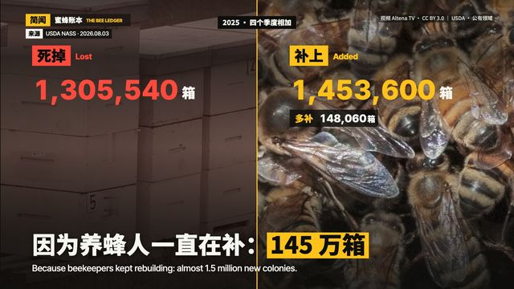

- **Nama asli:** Caption News · 字幕新闻
- **Demo:** *The Bee Ledger* (60 detik) — America lost 1.3 million bee colonies, yet the count rose 6 %: a news short that works with the sound off.
- **Gaya:** Berita gaya media sosial yang tetap terbaca tanpa suara: rekaman, foto, dan dokumen asli sebagai latar, dengan teks raksasa yang dihentakkan sebagai pemeran utama.
- **Cocok untuk:** berita sosmed, penjelasan laporan, data singkat
- **Skill:** [`styles/caption-news/STYLE.md`](https://github.com/lemomo-ai/lemo-opuscar/blob/main/styles/caption-news/STYLE.md)

<a id="newsreel"></a>

### 02. Newsreel 1920-an — `newsreel`

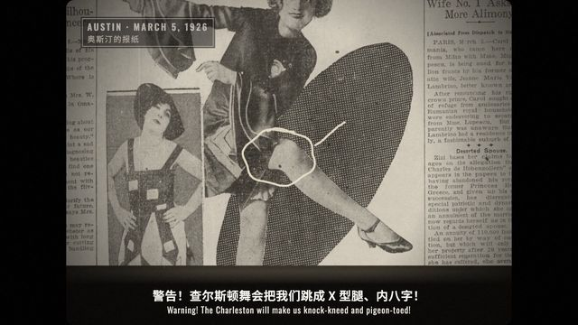

- **Nama asli:** 1920s Newsreel · 1920s 新闻影片
- **Demo:** *Knock-Knee Alert* (55 detik) — 1926: the papers say the Charleston will ruin America's knees; at Ford's own picnic the kids dance it anyway.
- **Gaya:** Film berita bersuara era akhir 1920-an dari arsip asli: ident sorot lampu dan bola dunia, fanfare kuningan, koran yang berputar ke layar.
- **Cocok untuk:** kisah sejarah, tren zaman dulu, peringatan
- **Pilar UDcation:** 🏛️ Ruang Nusantara
- **Skill:** [`styles/newsreel/STYLE.md`](https://github.com/lemomo-ai/lemo-opuscar/blob/main/styles/newsreel/STYLE.md)

<a id="countdown"></a>

### 03. Layar Belah Hitung Mundur — `countdown`

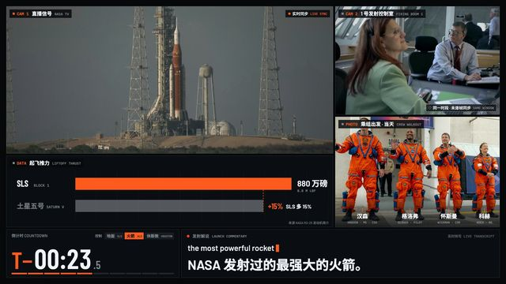

- **Nama asli:** Live Countdown Split-screen · 实时倒计时分屏
- **Demo:** *Counting Itself Down* (60 detik) — The last minute of the Artemis II launch, uncut: one cell opens to nine, and they merge into one at ignition.
- **Gaya:** Gaya editing: rekaman asli satu peristiwa yang punya titik nol (peluncuran, putusan, peluit akhir) diputar real-time dengan hitung mundur di layar belah.
- **Cocok untuk:** peluncuran, hitung mundur, acara langsung
- **Pilar UDcation:** 🌌 Ruang Semesta
- **Skill:** [`styles/countdown/STYLE.md`](https://github.com/lemomo-ai/lemo-opuscar/blob/main/styles/countdown/STYLE.md)

<a id="city-symphony"></a>

### 04. Simfoni Kota — `city-symphony`

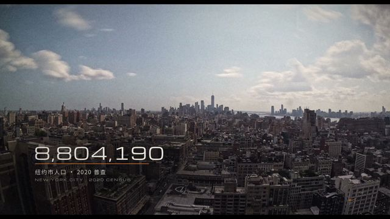

- **Nama asli:** City Symphony · 城市交响曲
- **Demo:** *One Day in New York* (52 detik) — One day in New York in time-lapse: rivers of light, a grid on the sixteenths, 1899 beside today.
- **Gaya:** Film kota yang dipotong seperti musik minimalis: time-lapse mengubah lalu lintas, keramaian, dan awan menjadi sungai cahaya, potongan makin rapat mengikuti musik.
- **Cocok untuk:** film kota, montase musik, pembuka
- **Skill:** [`styles/city-symphony/STYLE.md`](https://github.com/lemomo-ai/lemo-opuscar/blob/main/styles/city-symphony/STYLE.md)

<a id="visual-investigation"></a>

### 05. Investigasi Visual — `visual-investigation`

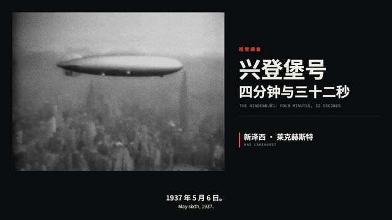

- **Nama asli:** Visual Investigation · 视觉调查
- **Demo:** *The Hindenburg: Four Minutes, 32 Seconds* (60 detik) — Newsreel, photos, testimony and the 1937 inquiry on one clock: five sources point to the same spot.
- **Gaya:** Meja investigasi dingin: rekaman, foto, dokumen, suara, dan peta dari satu peristiwa nyata disusun pada satu jam bersama agar saling memverifikasi.
- **Cocok untuk:** rekonstruksi, cek fakta, laporan insiden
- **Pilar UDcation:** 🌌 Ruang Semesta
- **Skill:** [`styles/visual-investigation/STYLE.md`](https://github.com/lemomo-ai/lemo-opuscar/blob/main/styles/visual-investigation/STYLE.md)

<a id="kino-montage"></a>

### 06. Montase Konstruktivis — `kino-montage`

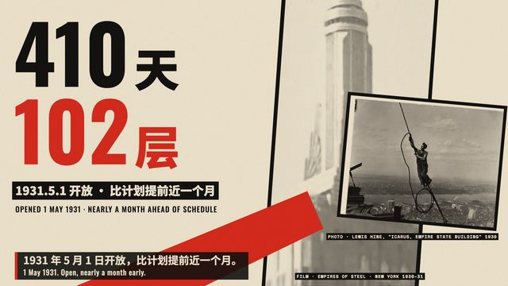

- **Nama asli:** Constructivist Montage · 构成主义蒙太奇
- **Demo:** *410 Days* (60 detik) — The Empire State's 1931 brochure credits its builders; the site film and Hine's photos answer: 2,500 a day.
- **Gaya:** Arsip rekaman, foto, dan dokumen dicetak sebagai satu poster tinta-kertas dengan satu warna merah, dipotong mengikuti ketukan mesin; pita diagonal membawa teks.
- **Cocok untuk:** sejarah industri, tonggak capaian, kerja kolektif
- **Pilar UDcation:** 🏛️ Ruang Nusantara
- **Skill:** [`styles/kino-montage/STYLE.md`](https://github.com/lemomo-ai/lemo-opuscar/blob/main/styles/kino-montage/STYLE.md)

<a id="telestrator"></a>

### 07. Papan Taktik Olahraga — `telestrator`

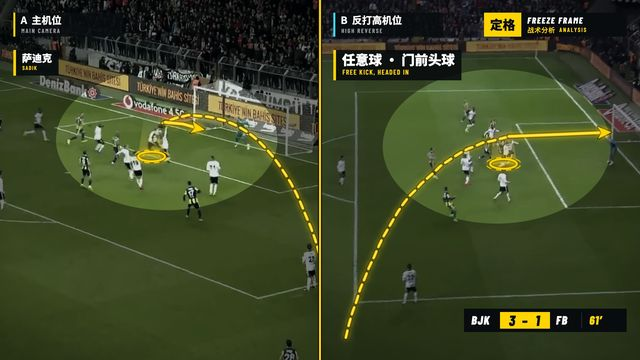

- **Nama asli:** Sports Telestrator · 体育战术板
- **Demo:** *Freeze Frame* (54 detik) — Down 3–0 at half-time, Fenerbahçe scored three in 12 minutes: freeze, draw, split screen, shot map.
- **Gaya:** Segmen analisis sepak bola TV: putar klip, mundurkan, bekukan, lalu gambar di atas siaran — lingkaran di kaki pemain, panah, garis.
- **Cocok untuk:** analisis olahraga, rangkuman laga, kepelatihan
- **Pilar UDcation:** 🌌 Ruang Semesta
- **Skill:** [`styles/telestrator/STYLE.md`](https://github.com/lemomo-ai/lemo-opuscar/blob/main/styles/telestrator/STYLE.md)

<a id="news-package"></a>

### 08. Paket Berita TV — `news-package`

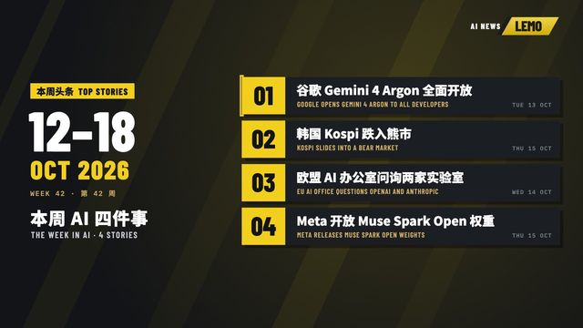

- **Nama asli:** Broadcast News Package · 电视新闻包装
- **Demo:** *The Week in AI* (54 detik) — Four AI stories from one week in a full on-air package: rundown, headline strap, price board, spec card.
- **Gaya:** Paket siaran ruang redaksi yang seluruhnya dibuat dengan kode: sting yang menjadi logo kanal, rundown berita hari ini, lower-third, dan peta.
- **Cocok untuk:** rangkuman berita, buletin, update pasar
- **Skill:** [`styles/news-package/STYLE.md`](https://github.com/lemomo-ai/lemo-opuscar/blob/main/styles/news-package/STYLE.md)

## Lukisan & Ilustrasi

<sub>Painting & Illustration</sub>

<a id="crayon-book"></a>

### 09. Buku Bergambar Krayon — `crayon-book`

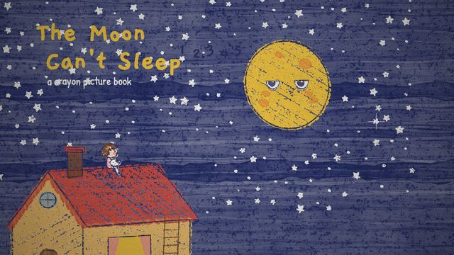

- **Nama asli:** Crayon Picture Book · 蜡笔儿童绘本
- **Demo:** *The Moon Can't Sleep* (52 detik) — The moon can't sleep, so a little girl climbs onto the roof to sing it a lullaby.
- **Gaya:** Halaman buku cerita yang digambar langsung dengan krayon lilin di kertas bertekstur, lalu sapuan cat air memunculkan yang tersembunyi di balik krayon.
- **Cocok untuk:** buku cerita, dongeng tidur, belajar anak
- **Pilar UDcation:** 🌌 Ruang Semesta
- **Skill:** [`styles/crayon-book/STYLE.md`](https://github.com/lemomo-ai/lemo-opuscar/blob/main/styles/crayon-book/STYLE.md)

<a id="watercolor"></a>

### 10. Kuas Cat Air — `watercolor`

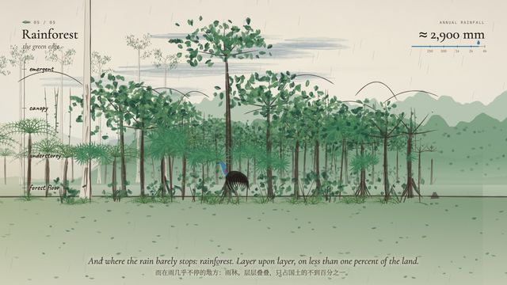

- **Nama asli:** Watercolor Brush · 水彩笔刷
- **Demo:** *Follow the Rain* (114 detik) — Follow the rain from Australia's red desert heart to its green coast in one unbroken painted walk.
- **Gaya:** Halaman jurnal lukis yang melukis dirinya sendiri: sapuan kuas transparan dengan efek kuas kering di kertas katun hangat, plus catatan tulisan tangan.
- **Cocok untuk:** dokumenter alam, perjalanan, penjelasan sains
- **Pilar UDcation:** 🌌 Ruang Semesta
- **Skill:** [`styles/watercolor/STYLE.md`](https://github.com/lemomo-ai/lemo-opuscar/blob/main/styles/watercolor/STYLE.md)

<a id="impasto"></a>

### 11. Lukisan Minyak Impasto — `impasto`

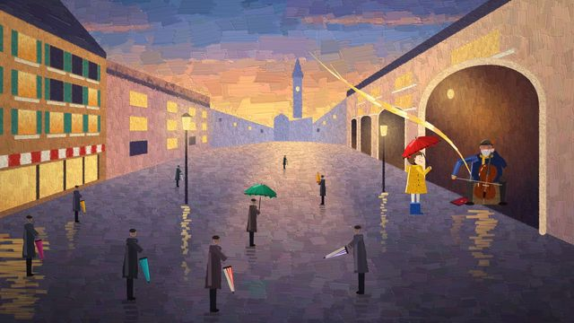

- **Nama asli:** Impasto Oil Painting · 油画厚涂
- **Demo:** *The Colour of Rain* (40 detik) — In a grey, rainy square one red umbrella opens, and a waltz paints the whole plaza in colour.
- **Gaya:** Cat minyak tebal yang dioles pisau palet: bidang warna besar dan tegas, disinari dari samping sehingga setiap guratan cat terlihat.
- **Cocok untuk:** video musik, seni & budaya, iklan emosional
- **Skill:** [`styles/impasto/STYLE.md`](https://github.com/lemomo-ai/lemo-opuscar/blob/main/styles/impasto/STYLE.md)

<a id="urban-sketch"></a>

### 12. Sketsa Kota · Pena & Cat Air — `urban-sketch`

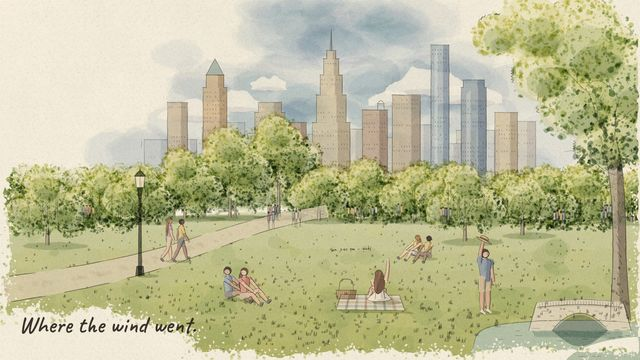

- **Nama asli:** Urban Sketch · Pen & Wash · 钢笔淡彩
- **Demo:** *Where the Wind Went* (33 detik) — A park that is only a pen sketch; wherever the wind carries her straw hat, colour follows.
- **Gaya:** Halaman buku sketsa yang digambar di lokasi: garis fineliner sepia yang goyah dan tidak menutup, ditetesi cat air transparan yang longgar.
- **Cocok untuk:** kota & perjalanan, arsitektur, gaya hidup
- **Pilar UDcation:** 🏛️ Ruang Nusantara
- **Skill:** [`styles/urban-sketch/STYLE.md`](https://github.com/lemomo-ai/lemo-opuscar/blob/main/styles/urban-sketch/STYLE.md)

<a id="colored-pencil"></a>

### 13. Ilustrasi Sains Pensil Warna — `colored-pencil`

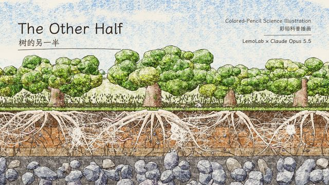

- **Nama asli:** Colored-Pencil Science Illustration · 彩铅科普插画
- **Demo:** *The Other Half* (51 detik) — Do trees feed each other? A pencil drawing sinks below the grass, follows one grain of sugar along a fungal thread to the next tree, and pulls back over a whole wood joined underground.
- **Gaya:** Dunia potongan melintang 3D (tanah, lapisan tanah, batu, struktur terkubur, makhluk hidup) digambar ulang tiap frame sebagai pelat pensil warna.
- **Cocok untuk:** potongan sains alam, penjelasan bergambar, struktur & proses tersembunyi
- **Pilar UDcation:** 🌌 Ruang Semesta
- **Skill:** [`styles/colored-pencil/STYLE.md`](https://github.com/lemomo-ai/lemo-opuscar/blob/main/styles/colored-pencil/STYLE.md)

## Sketsa & Papan Tulis

<sub>Sketch & Board</sub>

<a id="one-line"></a>

### 14. Gambar Satu Garis — `one-line`

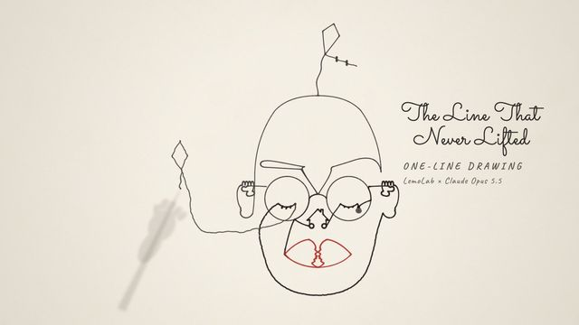

- **Nama asli:** One-line Drawing · 一笔画
- **Demo:** *The Line That Never Lifted* (48 detik) — One unbroken line draws a whole life, then the pen passes to a child.
- **Gaya:** Satu garis tinta yang tidak pernah terangkat dari kertas; semua di layar adalah garis itu, dan adegan tidak dipotong melainkan berubah bentuk.
- **Cocok untuk:** kisah brand, tonggak hidup, iklan minimalis
- **Skill:** [`styles/one-line/STYLE.md`](https://github.com/lemomo-ai/lemo-opuscar/blob/main/styles/one-line/STYLE.md)

<a id="whiteboard"></a>

### 15. Penjelasan Papan Tulis Putih — `whiteboard`

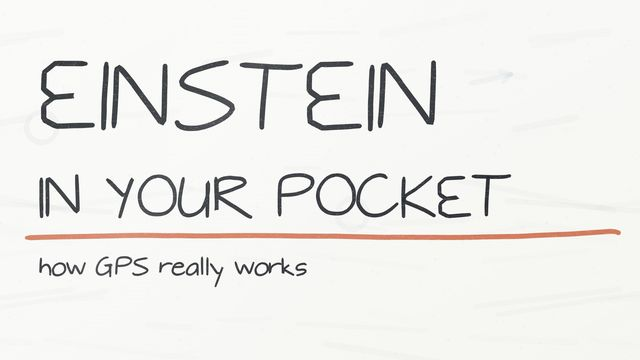

- **Nama asli:** Whiteboard Explainer · 白板讲解
- **Demo:** *Einstein in Your Pocket* (111 detik) — How your phone knows where you are: GPS, atomic clocks, and the 38 microseconds relativity adds every day.
- **Gaya:** Penjelasan yang digambar langsung di satu papan whiteboard mengkilap: tulisan tangan satu garis yang benar-benar ditulis goresan demi goresan.
- **Cocok untuk:** video penjelasan, kursus online, sains
- **Pilar UDcation:** 🔢 Ruang Hitung 🌌 Ruang Semesta
- **Skill:** [`styles/whiteboard/STYLE.md`](https://github.com/lemomo-ai/lemo-opuscar/blob/main/styles/whiteboard/STYLE.md)

<a id="chalkboard"></a>

### 16. Papan Tulis Kapur — `chalkboard`

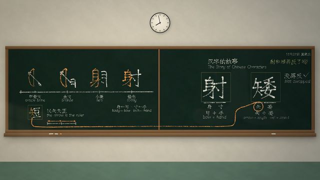

- **Nama asli:** Chalkboard · 黑板粉笔
- **Demo:** *The Story of Chinese Characters* (49 detik) — Chalk writes a popular claim about two characters, wipes it, and traces 射 back three thousand years.
- **Gaya:** Papan tulis kelas sungguhan tempat kapur menulis sendiri sesuai urutan goresan yang benar, tanpa tangan, tanpa batang kapur.
- **Cocok untuk:** asal-usul kata/simbol, membantah mitos, pelajaran
- **Pilar UDcation:** 🔢 Ruang Hitung
- **Skill:** [`styles/chalkboard/STYLE.md`](https://github.com/lemomo-ai/lemo-opuscar/blob/main/styles/chalkboard/STYLE.md)

<a id="sketchnote"></a>

### 17. Catatan Visual (Sketchnote) — `sketchnote`

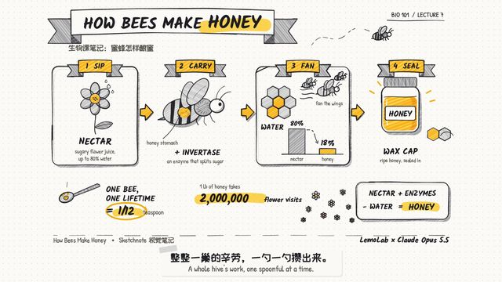

- **Nama asli:** Sketchnote · 视觉笔记
- **Demo:** *How Bees Make Honey* (51 detik) — One bee makes 1/12 of a teaspoon of honey in her life; the pen follows one yellow drop from flower to jar until the whole page is a poster.
- **Gaya:** Satu halaman catatan visual di kertas titik-titik yang digambar sambil ditonton: fineliner hitam, spidol abu untuk bayangan, satu warna aksen kuning.
- **Cocok untuk:** catatan kuliah, penjelasan sains, ringkasan satu halaman
- **Pilar UDcation:** 🔢 Ruang Hitung 🌌 Ruang Semesta
- **Skill:** [`styles/sketchnote/STYLE.md`](https://github.com/lemomo-ai/lemo-opuscar/blob/main/styles/sketchnote/STYLE.md)

<a id="stick-explainer"></a>

### 18. Penjelasan Orang Lidi — `stick-explainer`

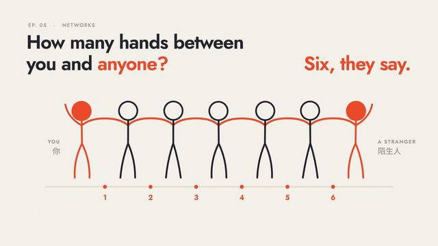

- **Nama asli:** Stick-figure Explainer · 火柴人讲解
- **Demo:** *Six Hands Away* (52 detik) — A chain of hands from you to a stranger: tested with letters in 1967, explained by rings that outgrow the Earth, closed around the globe.
- **Gaya:** Orang lidi sederhana di kertas hangat dengan satu warna aksen dan logika yang bisa ditonton: mereka berdiri di garis sistem, bereaksi, dan bergandengan.
- **Cocok untuk:** penjelasan sains, jaringan & ide sosial, perbandingan data
- **Pilar UDcation:** 🔢 Ruang Hitung
- **Skill:** [`styles/stick-explainer/STYLE.md`](https://github.com/lemomo-ai/lemo-opuscar/blob/main/styles/stick-explainer/STYLE.md)

<a id="ipad-sketch"></a>

### 19. Sketsa Tablet — `ipad-sketch`

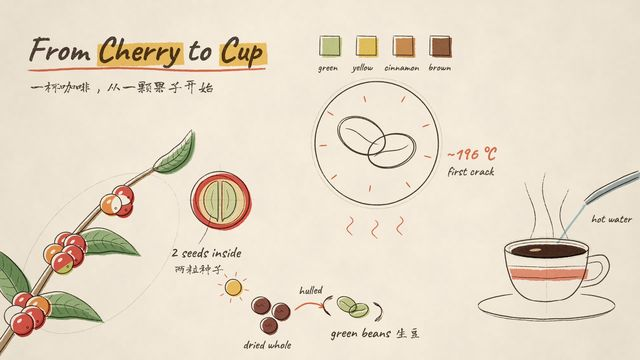

- **Nama asli:** Tablet Sketch Explainer · 平板速写讲解
- **Demo:** *From Cherry to Cup* (51 detik) — The coffee in your cup turns into a red cherry, then walks back to the cup: ripening, drying, roasting and grinding, one colour change at a time on a single pencil page.
- **Gaya:** Seluruh layar adalah kanvas krem di tablet saat seseorang menggambar sambil menjelaskan: garis pensil berbutir dulu, lalu blok warna datar.
- **Cocok untuk:** penjelasan makanan & minuman, kerajinan & tutorial, sains gaya hidup
- **Pilar UDcation:** 🌌 Ruang Semesta
- **Skill:** [`styles/ipad-sketch/STYLE.md`](https://github.com/lemomo-ai/lemo-opuscar/blob/main/styles/ipad-sketch/STYLE.md)

<a id="marker-paper"></a>

### 20. Spidol di Kertas — `marker-paper`

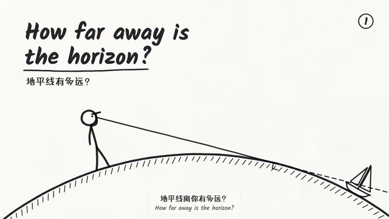

- **Nama asli:** Marker on Paper · 马克笔白纸速写
- **Demo:** *How Far Can You See?* (52 detik) — A felt-tip marker works out how far the horizon is from a beach, then shows that climbing a hundred times higher only lets you see ten times farther.
- **Gaya:** Bloknot kertas putih dof dan satu spidol permanen hitam, dengan spidol merah dan biru hanya untuk makna: biru yang diketahui, merah yang dicari.
- **Cocok untuk:** soal yang dikerjakan, penjelasan sains, pelajaran
- **Pilar UDcation:** 🔢 Ruang Hitung 🌌 Ruang Semesta
- **Skill:** [`styles/marker-paper/STYLE.md`](https://github.com/lemomo-ai/lemo-opuscar/blob/main/styles/marker-paper/STYLE.md)

## Kerajinan Tradisional

<sub>Traditional Crafts</sub>

<a id="ink-wash"></a>

### 21. Lukisan Tinta Tiongkok — `ink-wash`

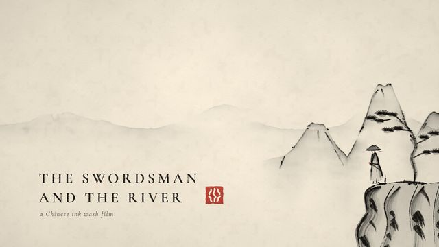

- **Nama asli:** Chinese Ink Wash · 中国水墨
- **Demo:** *The Swordsman and the River* (48 detik) — A swordsman crosses the river on the water and splits the current with a single stroke.
- **Gaya:** Lukisan tinta xieyi di kertas nasi yang dianimasikan: kertas kosong adalah ruang, satu sapuan kuas menjadi gunung, ombak, gerak, atau potongan.
- **Cocok untuk:** kisah silat, brand budaya, puisi
- **Pilar UDcation:** 🏛️ Ruang Nusantara
- **Skill:** [`styles/ink-wash/STYLE.md`](https://github.com/lemomo-ai/lemo-opuscar/blob/main/styles/ink-wash/STYLE.md)

<a id="shadow-puppet"></a>

### 22. Wayang Bayangan — `shadow-puppet`

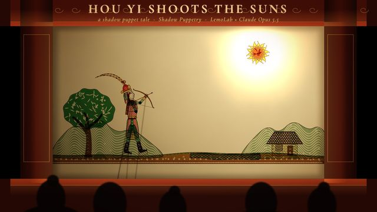

- **Nama asli:** Shadow Puppetry · 皮影戏
- **Demo:** *Hou Yi Shoots the Suns* (54 detik) — Ten suns scorch the earth until the archer Hou Yi draws his bow, told with leather puppets on a lit screen.
- **Gaya:** Teater bayangan Tiongkok: wayang kulit tembus cahaya yang diukir seperti renda, ditekan ke layar kain dan disinari lampu minyak dari belakang. Sangat dekat dengan wayang kulit kita.
- **Cocok untuk:** mitos & cerita rakyat, warisan budaya, festival
- **Pilar UDcation:** 🏛️ Ruang Nusantara
- **Skill:** [`styles/shadow-puppet/STYLE.md`](https://github.com/lemomo-ai/lemo-opuscar/blob/main/styles/shadow-puppet/STYLE.md)

<a id="ukiyoe"></a>

### 23. Ukiyo-e — `ukiyoe`

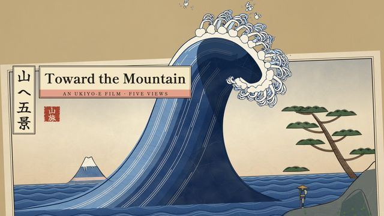

- **Nama asli:** Ukiyo-e · 浮世绘
- **Demo:** *Toward the Mountain* (44 detik) — A traveller walks toward a distant mountain; every shot is a woodblock print, a great wave at the climax, the mountain and the whole scroll at the end.
- **Gaya:** Cetak balok kayu era Edo yang dihidupkan: blok warna datar, garis tinta ukir, langit gradasi bokashi, tekstur kertas, kamera bergerak di atas cetakan.
- **Cocok untuk:** perjalanan, budaya Jepang, puisi
- **Pilar UDcation:** 🏛️ Ruang Nusantara
- **Skill:** [`styles/ukiyoe/STYLE.md`](https://github.com/lemomo-ai/lemo-opuscar/blob/main/styles/ukiyoe/STYLE.md)

<a id="papercut-red"></a>

### 24. Guntingan Kertas Merah — `papercut-red`

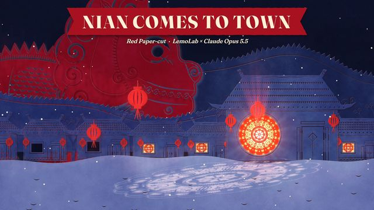

- **Nama asli:** Red Paper-cut · 红色窗花剪纸
- **Demo:** *Nian Comes to Town* (49 detik) — On New Year's Eve the beast Nian comes to town, and one girl's giant paper-cut lights up the village to scare it off.
- **Gaya:** Guntingan kertas jendela Tiongkok yang dihidupkan: potongan merah bersendi di atas kertas, guntingannya adalah gambarnya dan lubangnya adalah cahayanya.
- **Cocok untuk:** Imlek, ucapan hari raya, cerita rakyat
- **Pilar UDcation:** 🏛️ Ruang Nusantara
- **Skill:** [`styles/papercut-red/STYLE.md`](https://github.com/lemomo-ai/lemo-opuscar/blob/main/styles/papercut-red/STYLE.md)

<a id="paper-lantern"></a>

### 25. Kotak Lampu Kertas Ukir — `paper-lantern`

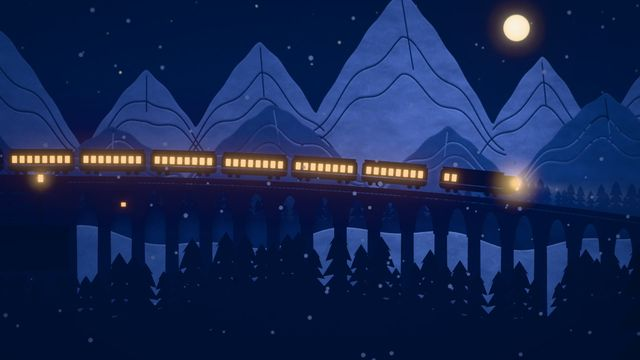

- **Nama asli:** Paper-cut Lightbox · 纸雕灯影
- **Demo:** *The Last Night Train* (51 detik) — An old night train makes its last run, from a snowy mountain halt through a long tunnel to the sea, its lit windows going out one by one at the end of the line.
- **Gaya:** Kotak bayangan kertas berlapis yang disinari dari belakang: 6–9 lembar karton ukir ditumpuk, cahaya hangat menembus kertas dan jendela-jendela kecil.
- **Cocok untuk:** perjalanan, perpisahan & peringatan, kisah tempat
- **Pilar UDcation:** 🏛️ Ruang Nusantara
- **Skill:** [`styles/paper-lantern/STYLE.md`](https://github.com/lemomo-ai/lemo-opuscar/blob/main/styles/paper-lantern/STYLE.md)

<a id="stained-glass"></a>

### 26. Kaca Patri — `stained-glass`

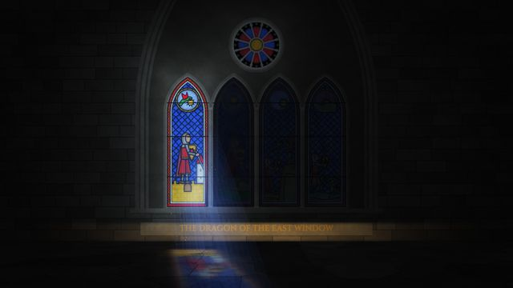

- **Nama asli:** Stained Glass · 彩色玻璃窗
- **Demo:** *The Dragon of the East Window* (56 detik) — Sunlight crosses a cathedral window from dawn to dusk, waking each pane of a knight-and-dragon tale.
- **Gaya:** Jendela kaca patri abad pertengahan dari dalam aula batu gelap, hidup hanya di tempat sinar matahari menyentuh: cahaya adalah jam, kamera, dan ceritanya.
- **Cocok untuk:** legenda, warisan budaya, cerita hari raya
- **Pilar UDcation:** 🌌 Ruang Semesta
- **Skill:** [`styles/stained-glass/STYLE.md`](https://github.com/lemomo-ai/lemo-opuscar/blob/main/styles/stained-glass/STYLE.md)

<a id="gilded-illumination"></a>

### 27. Miniatur Bersepuh Emas — `gilded-illumination`

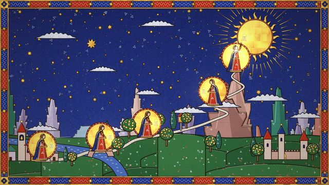

- **Nama asli:** Gilded Illumination · 金箔彩绘
- **Demo:** *Borrowed Light* (47 detik) — In a painted world where only gold shines, the sun goes out; a girl carries the last lamp up the mountain and gives it its light back.
- **Gaya:** Seluruh layar adalah satu lukisan miniatur bersepuh emas tempat cerita terjadi: pigmen mineral datar dalam garis tinta tegas, sorotan timah putih, daun emas.
- **Cocok untuk:** fabel, film pendek hari raya, kisah asal-usul brand
- **Pilar UDcation:** 🏛️ Ruang Nusantara
- **Skill:** [`styles/gilded-illumination/STYLE.md`](https://github.com/lemomo-ai/lemo-opuscar/blob/main/styles/gilded-illumination/STYLE.md)

## Cetak & Seni Grafis

<sub>Print & Printmaking</sub>

<a id="risograph"></a>

### 28. Cetak Risograf — `risograph`

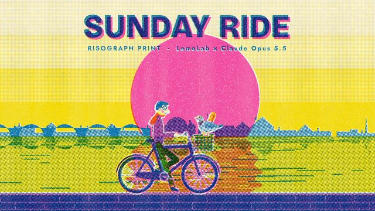

- **Nama asli:** Risograph Print · 孔版印刷
- **Demo:** *Sunday Ride* (40 detik) — A Sunday-morning bike ride through the city — bakery, park, riverside — each stop adding an ink until three misregistered plates overprint.
- **Gaya:** Animasi yang tampak dicetak frame demi frame dengan mesin stensil: dua-tiga tinta spot transparan bertumpuk di kertas hangat, titik halftone, registrasi meleset.
- **Cocok untuk:** brand indie, zine, gaya hidup
- **Skill:** [`styles/risograph/STYLE.md`](https://github.com/lemomo-ai/lemo-opuscar/blob/main/styles/risograph/STYLE.md)

<a id="halftone-dossier"></a>

### 29. Berkas Halftone — `halftone-dossier`

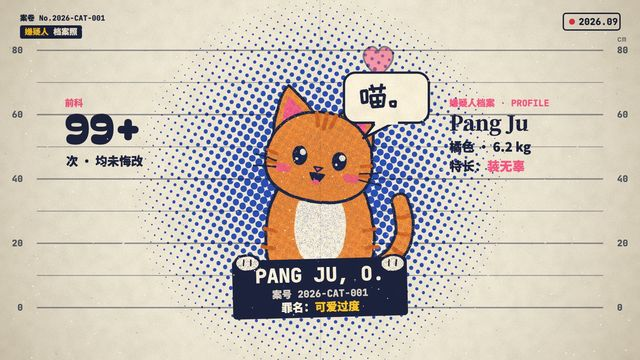

- **Nama asli:** Halftone Dossier · 网点档案
- **Demo:** *Case File: Chubby* (30 detik) — A chubby orange cat stands trial for testing gravity and 4 a.m. parkour, and walks free.
- **Gaya:** Berkas kasus cetakan retro: kertas arsip krem, titik halftone dalam beberapa tinta datar, judul raksasa dengan bayangan meleset, cap karet.
- **Cocok untuk:** humor, konten hewan, video pendek sosmed
- **Skill:** [`styles/halftone-dossier/STYLE.md`](https://github.com/lemomo-ai/lemo-opuscar/blob/main/styles/halftone-dossier/STYLE.md)

<a id="woodcut"></a>

### 30. Cetak Cukil Kayu — `woodcut`

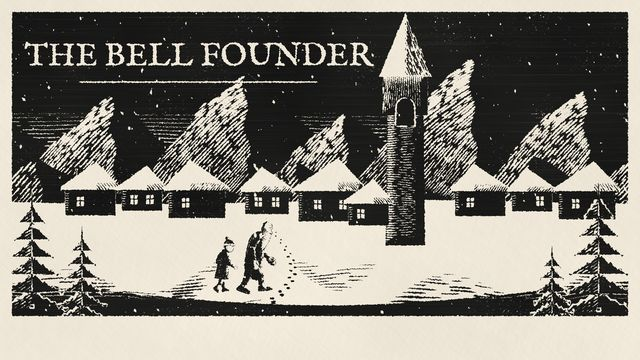

- **Nama asli:** Woodcut Print · 木刻版画
- **Demo:** *The Bell Founder* (58 detik) — A village spends a whole winter casting one bell; the first time it rings, the snow stops.
- **Gaya:** Cetak relief yang mengukir dirinya sendiri: setiap frame adalah balok kayu hitam, dan cahaya hanya ada di tempat pisau mencungkilnya. Maksimal satu warna.
- **Cocok untuk:** cerita rakyat, brand kerajinan, trailer buku
- **Pilar UDcation:** 🏛️ Ruang Nusantara
- **Skill:** [`styles/woodcut/STYLE.md`](https://github.com/lemomo-ai/lemo-opuscar/blob/main/styles/woodcut/STYLE.md)

<a id="engraving"></a>

### 31. Gravir Pelat Tembaga — `engraving`

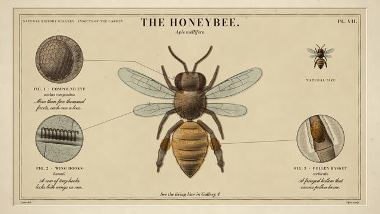

- **Nama asli:** Copperplate Engraving · 铜版画
- **Demo:** *The Honeybee, Plate VII* (40 detik) — A natural-history plate engraves itself: the burin cuts the copper, the bee builds up line by line, and a watercolour wash brings it to life.
- **Gaya:** Pelat intaglio yang menggravir dirinya: pahat memotong garis ke tembaga, cetakan ditarik, dan gambar terbangun — garis luar, arsir, arsir silang.
- **Cocok untuk:** label museum, penjelasan sains, warisan brand
- **Pilar UDcation:** 🌌 Ruang Semesta
- **Skill:** [`styles/engraving/STYLE.md`](https://github.com/lemomo-ai/lemo-opuscar/blob/main/styles/engraving/STYLE.md)

<a id="silkscreen-poster"></a>

### 32. Poster Wisata Sablon — `silkscreen-poster`

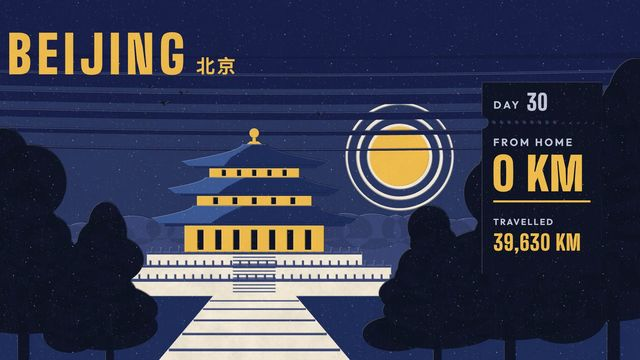

- **Nama asli:** Silkscreen Travel Poster · 丝印旅行海报
- **Demo:** *The Long Way Home* (50 detik) — A traveller crosses the world one full-bleed screen print at a time, a ticket stub counting the distance from home, until the far side turns into the way back.
- **Gaya:** Tinta datar buram bertepi tegas yang disablon satu warna demi satu: 4–6 tinta per poster, pita warna bertingkat alih-alih gradasi.
- **Cocok untuk:** panduan destinasi, pariwisata, poster acara
- **Pilar UDcation:** 🏛️ Ruang Nusantara
- **Skill:** [`styles/silkscreen-poster/STYLE.md`](https://github.com/lemomo-ai/lemo-opuscar/blob/main/styles/silkscreen-poster/STYLE.md)

<a id="printed-long-take"></a>

### 33. Cetak Gores Satu Bidikan — `printed-long-take`

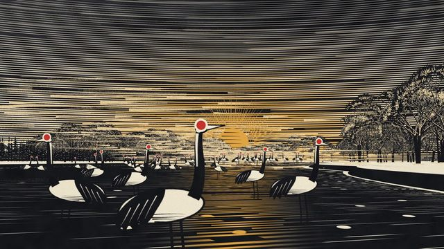

- **Nama asli:** Scratchboard Long Take · 刮版画长镜头
- **Demo:** *Thirty-Three Cranes* (60 detik) — Red-crowned cranes in a Hokkaido valley, one scratchboard take, counted back from 33 to 1,927.
- **Gaya:** Dunia 3D yang dirender sebagai cetak gores (scratchboard), tinta dan kertas dengan satu warna merah, dilintasi satu gerak kamera tanpa putus.
- **Cocok untuk:** perjalanan, satwa liar, lanskap
- **Skill:** [`styles/printed-long-take/STYLE.md`](https://github.com/lemomo-ai/lemo-opuscar/blob/main/styles/printed-long-take/STYLE.md)

<a id="pop-art"></a>

### 34. Pop Art — `pop-art`

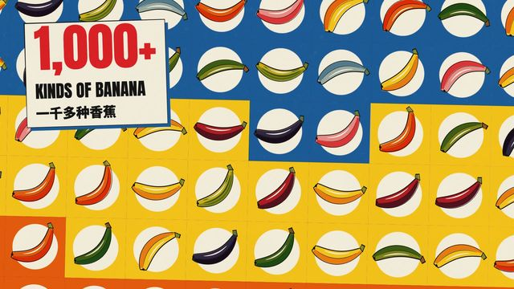

- **Nama asli:** Pop Art · 波普艺术
- **Demo:** *The Same Banana* (52 detik) — Almost every banana in the shops is one plant, copied: a wall of identical prints, an old banana eaten black by dots, and a wave of colour that turns into many bananas.
- **Gaya:** Bahasa poster sablon pop art tahun 60-an untuk bercerita: titik Ben-Day, garis hitam tebal, merah-kuning-biru datar.
- **Cocok untuk:** penjelasan benda sehari-hari, poster produk, cerita data kecil
- **Pilar UDcation:** 🔢 Ruang Hitung
- **Skill:** [`styles/pop-art/STYLE.md`](https://github.com/lemomo-ai/lemo-opuscar/blob/main/styles/pop-art/STYLE.md)

<a id="vintage-collage"></a>

### 35. Kolase Gravir Antik — `vintage-collage`

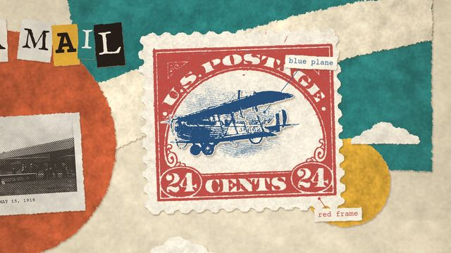

- **Nama asli:** Vintage Engraving Collage · 复古版画拼贴
- **Demo:** *The Inverted Jenny* (52 detik) — A 1918 airmail sheet printed with its plane upside down: bought for $24, cut up and scattered, and number 66 is still missing.
- **Gaya:** Kolase majalah di meja kertas: gravir domain publik, perangko, foto lama, dan cetakan bekas digunting dengan margin putih lalu disusun.
- **Cocok untuk:** sejarah suatu benda, penjelasan ide gaya majalah, kisah arsip
- **Pilar UDcation:** 🔢 Ruang Hitung 🏛️ Ruang Nusantara
- **Skill:** [`styles/vintage-collage/STYLE.md`](https://github.com/lemomo-ai/lemo-opuscar/blob/main/styles/vintage-collage/STYLE.md)

## Grafis & Tipografi

<sub>Graphic & Type</sub>

<a id="swiss-motion"></a>

### 36. Grafis Gerak Swiss — `swiss-motion`

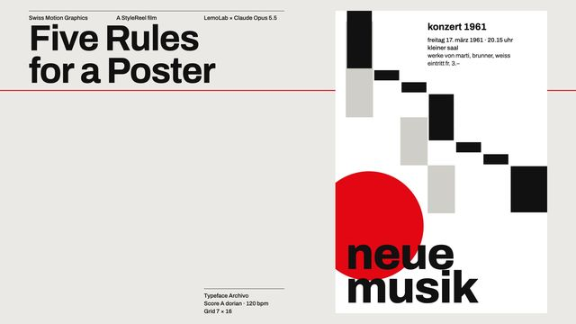

- **Nama asli:** Swiss Motion Graphics · 瑞士动态排版
- **Demo:** *Five Rules for a Poster* (44 detik) — A concert poster lays itself out by five Swiss design rules; the fifth is to break just one.
- **Gaya:** Gaya Tipografi Internasional dalam gerak: grid modular, satu jenis huruf, satu warna sinyal, dan gerakan setepat mesin cetak.
- **Cocok untuk:** identitas brand, acara, edukasi desain
- **Pilar UDcation:** 🔢 Ruang Hitung
- **Skill:** [`styles/swiss-motion/STYLE.md`](https://github.com/lemomo-ai/lemo-opuscar/blob/main/styles/swiss-motion/STYLE.md)

<a id="spy-titles"></a>

### 37. Pembuka Film Mata-mata 60-an — `spy-titles`

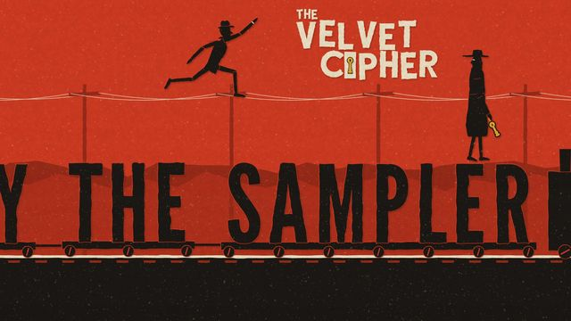

- **Nama asli:** 60s Spy Title Sequence · 60s 间谍片头
- **Demo:** *The Velvet Cipher* (44 detik) — Opening titles for an imaginary 1964 spy film: a chase for a stolen key until the shapes lock into the title.
- **Gaya:** Pembuka film potongan kertas empat tinta untuk film yang tak pernah ada: siluet bergerak di set yang dibangun dari tulisan kredit itu sendiri.
- **Cocok untuk:** sekuens judul, pembuka acara, trailer
- **Skill:** [`styles/spy-titles/STYLE.md`](https://github.com/lemomo-ai/lemo-opuscar/blob/main/styles/spy-titles/STYLE.md)

<a id="art-deco"></a>

### 38. Art Deco — `art-deco`

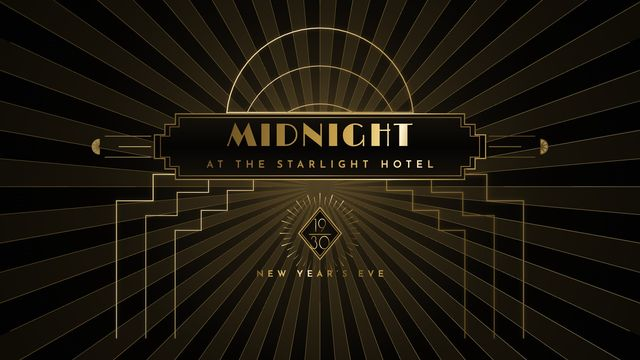

- **Nama asli:** Art Deco · 装饰艺术
- **Demo:** *Midnight at the Starlight Hotel* (58 detik) — A grand hotel, 1930: a bellboy races lifts and revolving doors to deliver one letter before midnight.
- **Gaya:** Pernis hitam, garis emas terukir, dan geometri airbrush: poster 1930-an yang bergerak, setiap komposisi punya sumbu tengah.
- **Cocok untuk:** kemewahan & perhotelan, gala, undangan
- **Skill:** [`styles/art-deco/STYLE.md`](https://github.com/lemomo-ai/lemo-opuscar/blob/main/styles/art-deco/STYLE.md)

<a id="pictogram-motion"></a>

### 39. Gerak Piktogram — `pictogram-motion`

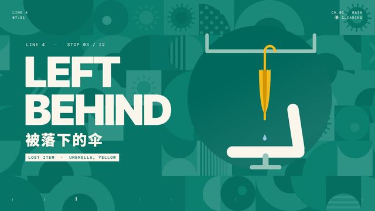

- **Nama asli:** Pictogram Motion · 象形运动图形
- **Demo:** *Left Behind* (50 detik) — A yellow umbrella left on a bus waits out a sunny day on the lost-property shelf, then opens with 312 others when the storm comes back: objects, vehicles, weather and signs as beat-locked geometric pictograms.
- **Gaya:** Film yang terkunci ke ketukan, dibangun dari grid bujur sangkar berisi lingkaran, setengah cakram, dan sel bermotif, plus piktogram.
- **Cocok untuk:** layanan publik & kota, film identitas acara, penjelasan lewat simbol
- **Pilar UDcation:** 🔢 Ruang Hitung
- **Skill:** [`styles/pictogram-motion/STYLE.md`](https://github.com/lemomo-ai/lemo-opuscar/blob/main/styles/pictogram-motion/STYLE.md)

<a id="bauhaus-shapes"></a>

### 40. Bentuk Bauhaus — `bauhaus-shapes`

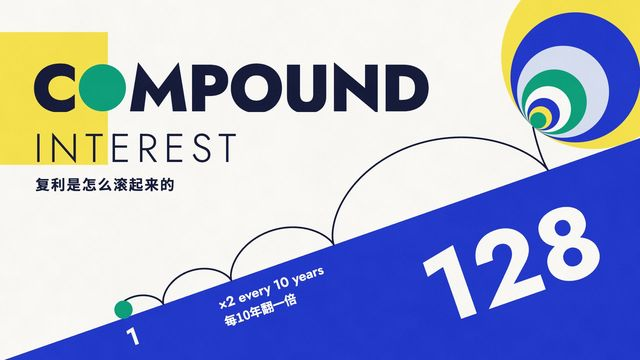

- **Nama asli:** Bauhaus Shapes · 包豪斯几何
- **Demo:** *COMPOUND* (52 detik) — One dot doubles every ten years: 128 after seventy, 6.02 without compounding, and the last ten years are worth all the rest.
- **Gaya:** Penjelasan hanya dengan lingkaran, persegi, segitiga, busur, dan garis lurus berwarna opak di kertas terang; setiap bentuk adalah besaran.
- **Cocok untuk:** penjelasan keuangan & ekonomi, mekanisme & prinsip, kartu judul bab
- **Pilar UDcation:** 🔢 Ruang Hitung 🌌 Ruang Semesta
- **Skill:** [`styles/bauhaus-shapes/STYLE.md`](https://github.com/lemomo-ai/lemo-opuscar/blob/main/styles/bauhaus-shapes/STYLE.md)

<a id="flat-space-explainer"></a>

### 41. Penjelasan Zoom Skala — `flat-space-explainer`

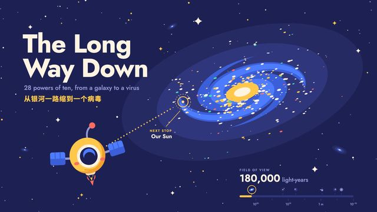

- **Nama asli:** Scale Zoom Explainer · 扁平尺度漫游
- **Demo:** *The Long Way Down* (52 detik) — A little probe whose eye is a zoom lens fires a dotted sight line at each next stop and takes us from the Milky Way down to a virus.
- **Gaya:** Bentuk datar solid di latar biru malam pekat, digambar sesuai skala sebenarnya, dipandu zoom yang menjelajah dari kecil ke sangat besar.
- **Cocok untuk:** penjelasan sains, skala & ukuran, kelas
- **Pilar UDcation:** 🔢 Ruang Hitung 🌌 Ruang Semesta
- **Skill:** [`styles/flat-space-explainer/STYLE.md`](https://github.com/lemomo-ai/lemo-opuscar/blob/main/styles/flat-space-explainer/STYLE.md)

<a id="text-flash-cuts"></a>

### 42. Kilatan Teks (✦ butuh generator gambar) — `text-flash-cuts`

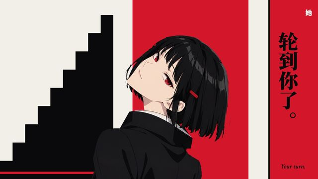

- **Nama asli:** Text Flash Cuts · 文字闪切
- **Demo:** *Behind You* (46 detik) — A letter, a phone call, a wall of windows, thirteen steps: the girl who told him not to look back is always one step closer, until she turns her head.
- **Gaya:** Anime TV avant-garde gaya "text frame" awal 2000-an: kartu judul Mincho tebal layar penuh yang muncul 2–9 frame di antara gambar.
- **Cocok untuk:** trailer suspense & drama, sekuens judul, film manifesto
- **Skill:** [`styles/text-flash-cuts/STYLE.md`](https://github.com/lemomo-ai/lemo-opuscar/blob/main/styles/text-flash-cuts/STYLE.md)

<a id="silhouette-rhythm"></a>

### 43. Ritme Siluet — `silhouette-rhythm`

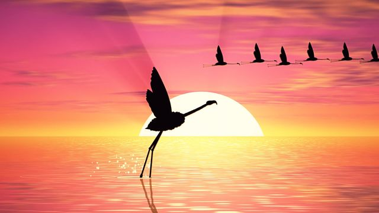

- **Nama asli:** Silhouette Rhythm · 剪影律动
- **Demo:** *Half a Beat* (49 detik) — A flock of flamingos moves on every beat, and one young bird is always half a beat late; the ripples the others left on the water teach it the beat.
- **Gaya:** Siluet hitam pekat di depan langit senja jenuh, berganti pose setiap ketukan; pada ketukan kunci semuanya membeku dan hanya langit yang bergerak.
- **Cocok untuk:** video musik, film olahraga & tim, pembuka festival
- **Skill:** [`styles/silhouette-rhythm/STYLE.md`](https://github.com/lemomo-ai/lemo-opuscar/blob/main/styles/silhouette-rhythm/STYLE.md)

## Diagram Garis

<sub>Line Diagrams</sub>

<a id="blueprint"></a>

### 44. Cetak Biru — `blueprint`


- **Nama asli:** Blueprint · 工程蓝图
- **Demo:** *Patent Pending: The Cloud Catcher* (47 detik) — An inventor's blueprint draws, explodes and assembles a cloud-catching machine, and its revision cloud starts to rain.
- **Gaya:** Gambar teknik yang hidup di kertas cyanotype: garis teknis putih di biru Prusia, digambar sesuai urutan drafting, dengan anotasi dan ukuran.
- **Cocok untuk:** teknik, peluncuran perangkat keras, penjelasan teknologi
- **Pilar UDcation:** 🔢 Ruang Hitung 🌌 Ruang Semesta
- **Skill:** [`styles/blueprint/STYLE.md`](https://github.com/lemomo-ai/lemo-opuscar/blob/main/styles/blueprint/STYLE.md)

<a id="iso-infographic"></a>

### 45. Infografis Isometrik — `iso-infographic`

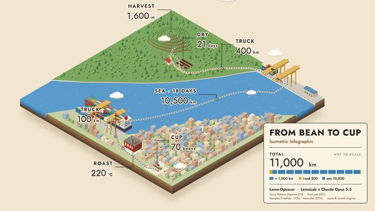

- **Nama asli:** Isometric Infographic · 等距信息图
- **Demo:** *From Bean to Cup* (59 detik) — A coffee's journey from the plantation to your hands, across one isometric world.
- **Gaya:** Diagram sistem yang hidup: diorama isometrik dari balok datar tiga nada, label tinta tipis, dan angka Isotype; benda terbuka untuk memperlihatkan isinya.
- **Cocok untuk:** penjelasan proses, rantai pasok, laporan tahunan
- **Pilar UDcation:** 🔢 Ruang Hitung
- **Skill:** [`styles/iso-infographic/STYLE.md`](https://github.com/lemomo-ai/lemo-opuscar/blob/main/styles/iso-infographic/STYLE.md)

<a id="teardown"></a>

### 46. Bongkar Urai Produk — `teardown`

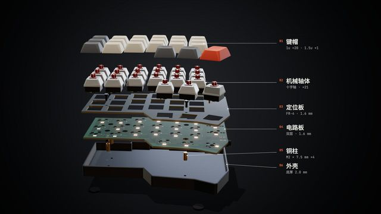

- **Nama asli:** Exploded Teardown · 产品拆解
- **Demo:** *21 Keys, Opened* (39 detik) — Half an open-source keyboard comes apart in one orbit, down to the chip, then closes with its real dimensions.
- **Gaya:** Produk nyata yang dibangun dari file tekniknya (CAD, PCB, BOM), disinari seperti foto studio lalu dibongkar komponen demi komponen di depan kamera.
- **Cocok untuk:** peluncuran perangkat keras, halaman produk, penjelasan spesifikasi
- **Pilar UDcation:** 🌌 Ruang Semesta
- **Skill:** [`styles/teardown/STYLE.md`](https://github.com/lemomo-ai/lemo-opuscar/blob/main/styles/teardown/STYLE.md)

<a id="hardcore-info"></a>

### 47. Potongan Gambar Garis — `hardcore-info`

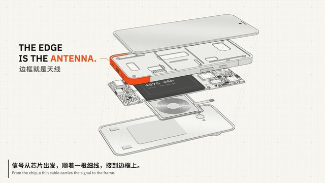

- **Nama asli:** Line-Art Cutaway · 线稿剖面图解
- **Demo:** *Where Is Your Phone's Antenna?* (52 detik) — A phone loses signal when held by the corner; taken apart, its metal frame turns out to be the antenna, cut into pieces your hand can bridge.
- **Gaya:** Objek berukuran nyata yang dimodel 3D lalu ditelusuri langsung menjadi gambar teknik garis hitam di kertas putih: berputar, terurai, dipotong.
- **Cocok untuk:** penjelasan perangkat keras, rekayasa produk, pendidikan sains
- **Pilar UDcation:** 🌌 Ruang Semesta
- **Skill:** [`styles/hardcore-info/STYLE.md`](https://github.com/lemomo-ai/lemo-opuscar/blob/main/styles/hardcore-info/STYLE.md)

<a id="precise-mechanism"></a>

### 48. Mekanisme Berkode Warna — `precise-mechanism`

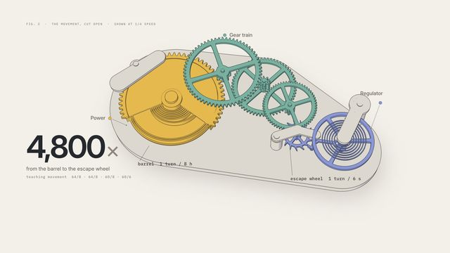

- **Nama asli:** Color-Coded Mechanism · 分色机械图解
- **Demo:** *Three Systems Keep the Time* (52 detik) — A watch with no battery is cut open: its three systems are dyed one by one, the train races when the escapement is pulled out, and one slowed tick lets it all out again.
- **Gaya:** Mekanisme nyata dalam 3D yang diwarnai seperti pelat anatomi: satu warna datar per subsistem, bagian yang dijelaskan diberi warna aksen.
- **Cocok untuk:** cara kerja mesin, penjelasan rekayasa, pengajaran sains
- **Pilar UDcation:** 🌌 Ruang Semesta
- **Skill:** [`styles/precise-mechanism/STYLE.md`](https://github.com/lemomo-ai/lemo-opuscar/blob/main/styles/precise-mechanism/STYLE.md)

<a id="instruction-manual"></a>

### 49. Seni Buku Panduan — `instruction-manual`

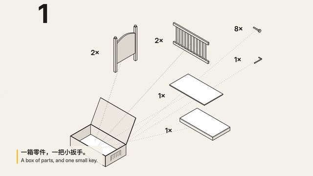

- **Nama asli:** Instruction Manual Art · 说明书插画
- **Demo:** *Step Ten* (51 detik) — Two first-timers build a crib from a flat-pack manual, ten steps on one 45° page; step ten was never in the manual.
- **Gaya:** Filmnya adalah buku panduan perakitan: kertas putih pucat, gambar garis hitam isometrik 45°, bagian putih datar, orang tanpa wajah.
- **Cocok untuk:** panduan perakitan, instruksi keselamatan, onboarding produk
- **Skill:** [`styles/instruction-manual/STYLE.md`](https://github.com/lemomo-ai/lemo-opuscar/blob/main/styles/instruction-manual/STYLE.md)

<a id="pen-plotter"></a>

### 50. Plotter Pena — `pen-plotter`

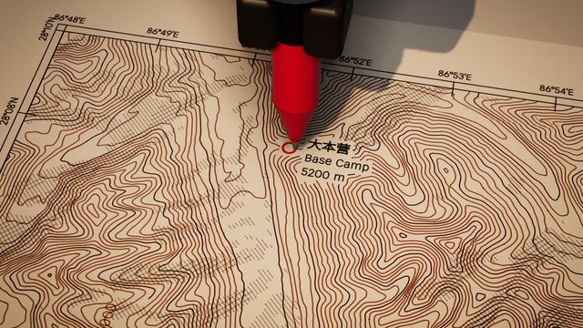

- **Nama asli:** Pen Plotter · 笔式绘图仪
- **Demo:** *8848.86* (50 detik) — At night under a desk lamp, a pen plotter draws Mount Qomolangma from real elevation data with four pens, and writes its height last.
- **Gaya:** Plotter pena di meja menggambar subjek goresan demi goresan: pena asli, tinta asli di kertas, gerak mesin asli. Peta, grafik, dan huruf muncul perlahan.
- **Cocok untuk:** peta & medan, pengukuran & catatan, gambar generatif & data
- **Pilar UDcation:** 🔢 Ruang Hitung
- **Skill:** [`styles/pen-plotter/STYLE.md`](https://github.com/lemomo-ai/lemo-opuscar/blob/main/styles/pen-plotter/STYLE.md)

<a id="assembly-line-diagram"></a>

### 51. Diagram Jalur Produksi — `assembly-line-diagram`

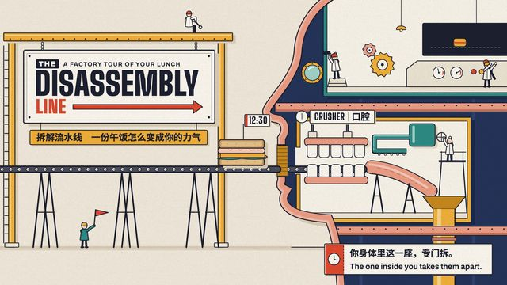

- **Nama asli:** Assembly-Line Diagram · 流水线图解
- **Demo:** *The Disassembly Line* (55 detik) — A body cut open as a factory that runs backwards: a 12:30 sandwich is taken apart station by station, and six hours later it runs for the bus.
- **Gaya:** Proses dijelaskan sebagai pabrik yang dibelah: siluet (tubuh, mesin, gedung, kota) diiris seperti rumah boneka menjadi ruang-ruang kerja.
- **Cocok untuk:** cara kerja proses, biologi & kedokteran, rantai pasok
- **Pilar UDcation:** 🌌 Ruang Semesta
- **Skill:** [`styles/assembly-line-diagram/STYLE.md`](https://github.com/lemomo-ai/lemo-opuscar/blob/main/styles/assembly-line-diagram/STYLE.md)

## Kartun

<sub>Cartoons</sub>

<a id="rubber-hose"></a>

### 52. Kartun Rubber Hose 1930-an — `rubber-hose`


- **Nama asli:** 1930s Rubber Hose Cartoon · 1930s 橡皮管卡通
- **Demo:** *Coffee Cup Chase* (50 detik) — A coffee cup chases a runaway sugar cube around the kitchen, 1930s-cartoon style.
- **Gaya:** Kartun hitam-putih bertinta tangan di mana setiap benda hidup dan bergoyang mengikuti band jazz.
- **Cocok untuk:** makanan & minuman, iklan retro, anak-anak
- **Skill:** [`styles/rubber-hose/STYLE.md`](https://github.com/lemomo-ai/lemo-opuscar/blob/main/styles/rubber-hose/STYLE.md)

<a id="cel-anime-80s"></a>

### 53. Anime Cel 80-an — `cel-anime-80s`


- **Nama asli:** 80s Cel Anime · 80 年代赛璐璐动画
- **Demo:** *City Lights, 1987* (59 detik) — A courier girl rides through a rain-soaked neon city to deliver a tape before the dawn launch.
- **Gaya:** Animasi cel lukis tangan era emas OVA Jepang, dibuat ulang dengan kode: cel datar dua nada di atas latar airbrush, neon menyala.
- **Cocok untuk:** video musik, trailer gim, nostalgia
- **Skill:** [`styles/cel-anime-80s/STYLE.md`](https://github.com/lemomo-ai/lemo-opuscar/blob/main/styles/cel-anime-80s/STYLE.md)

<a id="scifi-toon"></a>

### 54. Kartun Sitkom Fiksi Ilmiah — `scifi-toon`


- **Nama asli:** Sci-Fi Sitcom Toon · 科幻情景喜剧卡通
- **Demo:** *Coffee Run* (58 detik) — A jaded genius opens a portal just to buy coffee and tumbles through ever-stranger universes.
- **Gaya:** Sitkom animasi fiksi ilmiah: garis luar tebal bergetar, warna datar, duo yang reaksinya tak nyambung, portal bercahaya.
- **Cocok untuk:** komedi, brand teknologi, video pendek sosmed
- **Skill:** [`styles/scifi-toon/STYLE.md`](https://github.com/lemomo-ai/lemo-opuscar/blob/main/styles/scifi-toon/STYLE.md)

<a id="midcentury-toon"></a>

### 55. Kartun Pertengahan Abad — `midcentury-toon`


- **Nama asli:** Mid-century Cartoon · 50s 扁平卡通
- **Demo:** *Meet Pip* (40 detik) — A robot vacuum set up in three steps, told like a 1950s classroom film.
- **Gaya:** Warna datar dan animasi terbatas tahun 1950-an untuk film "ikuti langkahnya": warna dicetak sedikit meleset dari garis tinta.
- **Cocok untuk:** panduan setup, pusat bantuan, tutorial
- **Skill:** [`styles/midcentury-toon/STYLE.md`](https://github.com/lemomo-ai/lemo-opuscar/blob/main/styles/midcentury-toon/STYLE.md)

<a id="comic-history"></a>

### 56. Kartun Sejarah Komik — `comic-history`


- **Nama asli:** Comic History Cartoon · 搞笑历史卡通
- **Demo:** *One Piece of Paper* (51 detik) — Alsace-Lorraine changed hands four times between 1871 and 1945: each time someone tore off the paper and pasted a new piece, and the woman living on it never moved.
- **Gaya:** Negara-negara adalah wayang kertas yang disambung paku kuningan di atas peta kertas; yang merebut wilayah menggunting secarik peta.
- **Cocok untuk:** perubahan wilayah dalam sejarah, geopolitik ringan, perebutan pasar
- **Pilar UDcation:** 🏛️ Ruang Nusantara
- **Skill:** [`styles/comic-history/STYLE.md`](https://github.com/lemomo-ai/lemo-opuscar/blob/main/styles/comic-history/STYLE.md)

<a id="manga-panels"></a>

### 57. Panel Manga (✦ butuh generator gambar) — `manga-panels`


- **Nama asli:** Manga Panels · 黑白漫画分格
- **Demo:** *KOMA ONE: Thirty Frames a Second* (48 detik) — A street photographer chases a running light to the moment the pigeons rise; her pocket camera splits that second into thirty panels.
- **Gaya:** Halaman manga hitam-putih yang bergerak: tinta G-pen, titik screentone, satu warna spot, panel terbuka mengikuti ketukan.
- **Cocok untuk:** video musik, peluncuran produk, pembuka anime
- **Skill:** [`styles/manga-panels/STYLE.md`](https://github.com/lemomo-ai/lemo-opuscar/blob/main/styles/manga-panels/STYLE.md)

## Gim

<sub>Games</sub>

<a id="pixel-rpg"></a>

### 58. RPG Piksel 16-bit — `pixel-rpg`


- **Nama asli:** 16-bit Pixel RPG · 16-bit 像素 RPG
- **Demo:** *The Last Save Point* (54 detik) — At the final boss door a hero saves the game, and the save screen replays the whole journey.
- **Gaya:** Film pendek yang tampak, terdengar, dan berperilaku seperti RPG konsol pertengahan 90-an: 320×180 piksel, palet terbatas, kotak teks mengetik.
- **Cocok untuk:** trailer gim, rekap, nostalgia
- **Pilar UDcation:** 🔢 Ruang Hitung
- **Skill:** [`styles/pixel-rpg/STYLE.md`](https://github.com/lemomo-ai/lemo-opuscar/blob/main/styles/pixel-rpg/STYLE.md)

<a id="hd-2d"></a>

### 59. Piksel 2.5D — `hd-2d`


- **Nama asli:** 2.5D Pixel Art · 2.5D 像素
- **Demo:** *The Lampbearer* (76 detik) — The lighthouse goes dark; a girl carries the last flame through a night forest and up the storm cliffs.
- **Gaya:** Sprite piksel buatan tangan berdiri seperti guntingan kertas di diorama 3D yang berkabut dan bercahaya, dilihat dari sudut tinggi dengan efek tilt-shift.
- **Cocok untuk:** trailer gim, fantasi, film cerita
- **Skill:** [`styles/hd-2d/STYLE.md`](https://github.com/lemomo-ai/lemo-opuscar/blob/main/styles/hd-2d/STYLE.md)

<a id="microgame"></a>

### 60. Kegilaan Microgame — `microgame`


- **Nama asli:** Microgame Frenzy · 微游戏快闪
- **Demo:** *Five-Second Astronaut* (60 detik) — A clumsy cadet survives a five-second boot camp, faster and faster, until the boss: landing home.
- **Gaya:** Film party-game cepat: satu kata perintah, beberapa detik, satu aksi; setiap microgame digambar dengan gaya seni yang benar-benar berbeda.
- **Cocok untuk:** trailer gim, onboarding, video pendek sosmed
- **Pilar UDcation:** 🔢 Ruang Hitung
- **Skill:** [`styles/microgame/STYLE.md`](https://github.com/lemomo-ai/lemo-opuscar/blob/main/styles/microgame/STYLE.md)

<a id="game-show"></a>

### 61. Kuis Gim Ritme — `game-show`


- **Nama asli:** Rhythm Game Show · 节奏综艺
- **Demo:** *Rhythm of AI, 1997 → 2026* (149 detik) — The history of AI as a rhythm game: models take the stage on the beat, and a report card closes the show.
- **Gaya:** Acara variasi gim ritme berbasis vektor datar: maskot mirip mainan bergaris tebal di atas garis-garis warna permen, setiap hentakan pas di ketukan.
- **Cocok untuk:** linimasa teknologi, kilas balik tahunan, acara variasi
- **Skill:** [`styles/game-show/STYLE.md`](https://github.com/lemomo-ai/lemo-opuscar/blob/main/styles/game-show/STYLE.md)

## Film & Pita Kaset

<sub>Film & Tape</sub>

<a id="ascii-crt"></a>

### 62. Terminal ASCII CRT — `ascii-crt`


- **Nama asli:** CRT ASCII Terminal · CRT 字符终端
- **Demo:** *Tranquility.log* (60 detik) — A moon-base AI wakes after forty years to a signal from Earth, and replies by drawing “home” in characters.
- **Gaya:** Semua di layar adalah karakter asli pada grid monospace, menyala oleh fosfor monitor CRT monokrom lama.
- **Cocok untuk:** alat developer, fiksi ilmiah, brand teknologi
- **Pilar UDcation:** 🔢 Ruang Hitung
- **Skill:** [`styles/ascii-crt/STYLE.md`](https://github.com/lemomo-ai/lemo-opuscar/blob/main/styles/ascii-crt/STYLE.md)

<a id="silent-film"></a>

### 63. Film Bisu 1920-an — `silent-film`


- **Nama asli:** 1920s Silent Film · 1920s 默片
- **Demo:** *The Runaway Loaf* (54 detik) — A baker's boy chases a runaway loaf downhill, then breaks it in half for a hungry girl.
- **Gaya:** Film bisu ilustrasi gravir yang diproyeksikan di bioskop lama: garis tinta dan sapuan perak, gambar 4:3 yang berkedip di antara tirai beludru.
- **Cocok untuk:** komedi, brand retro, cerita tanpa dialog
- **Pilar UDcation:** 🏛️ Ruang Nusantara
- **Skill:** [`styles/silent-film/STYLE.md`](https://github.com/lemomo-ai/lemo-opuscar/blob/main/styles/silent-film/STYLE.md)

<a id="backrooms"></a>

### 64. Rekaman Ruang Liminal — `backrooms`


- **Nama asli:** Liminal Found Footage · 后室录像带
- **Demo:** *Night Shift Orientation* (60 detik) — A new night-shift hire films their first night in an endless yellow office, following the rules on the wall.
- **Gaya:** Kaset camcorder yang ditemukan dari ruang kosong tanpa ujung berlampu neon. Aturan, bukan monster.
- **Cocok untuk:** horor, misteri & ARG, teaser gim
- **Skill:** [`styles/backrooms/STYLE.md`](https://github.com/lemomo-ai/lemo-opuscar/blob/main/styles/backrooms/STYLE.md)

<a id="scratch-film"></a>

### 65. Film Gores — `scratch-film`


- **Nama asli:** Scratch Film · 胶片直刻
- **Demo:** *The Night Climb* (52 detik) — A finger-long lanternfish climbs half a kilometre in the dark, hides its shadow with its own lights, and turns out to be one of countless animals rising every night.
- **Gaya:** Animasi langsung: setiap gambar tampak digores di emulsi hitam dengan jarum dan diwarnai pewarna transparan, digambar ulang 15 kali per detik.
- **Cocok untuk:** hal yang terjadi dalam gelap, satu tanda menjadi sistem, petualangan cahaya & bayangan
- **Pilar UDcation:** 🌌 Ruang Semesta
- **Skill:** [`styles/scratch-film/STYLE.md`](https://github.com/lemomo-ai/lemo-opuscar/blob/main/styles/scratch-film/STYLE.md)

<a id="double-exposure"></a>

### 66. Eksposur Ganda — `double-exposure`


- **Nama asli:** Double Exposure · 双重曝光
- **Demo:** *Mountains and Seas* (50 detik) — From the mountains to the sea as night falls: a stag, a wolf, an eagle, a salmon and a whale, each carrying its own place inside its silhouette, until the whale's harbour lands on the real shore.
- **Gaya:** Siluet adalah jendela: bentuk hewan gelap dari eksposur pertama memuat foto kedua — tempat yang dibawa hewan itu.
- **Cocok untuk:** film brand & kota, pembuka dokumenter, intro video musik
- **Skill:** [`styles/double-exposure/STYLE.md`](https://github.com/lemomo-ai/lemo-opuscar/blob/main/styles/double-exposure/STYLE.md)

## Layar & Antarmuka

<sub>Screens & Interfaces</sub>

<a id="dark-keynote"></a>

### 67. Keynote Teknologi Gelap — `dark-keynote`


- **Nama asli:** Dark Tech Keynote · 暗色科技发布
- **Demo:** *Room to Think* (42 detik) — Launch film for Tidy, a fictional app: one buried cursor snaps hundreds of windows back into place.
- **Gaya:** Film peluncuran software dengan antarmuka sebagai bintangnya: gradasi hampir hitam, grid tipis, cahaya lembut, satu warna aksen brand.
- **Cocok untuk:** peluncuran produk, SaaS, keynote
- **Skill:** [`styles/dark-keynote/STYLE.md`](https://github.com/lemomo-ai/lemo-opuscar/blob/main/styles/dark-keynote/STYLE.md)

<a id="living-screencast"></a>

### 68. Screencast Maskot — `living-screencast`

> *Gambar tidak disertakan: poster demo ini memuat maskot Clawd dan antarmuka aplikasi Claude yang tidak berlisensi bebas. Lihat di [galeri resmi](https://lemomo-ai.github.io/lemo-opuscar/).*

- **Nama asli:** Mascot Screencast · 像素小人录屏
- **Demo:** *Clawd Moves In* (59 detik) — Clawd hops out of the terminal into the Claude app and acts out plan mode and self-checks in one take.
- **Gaya:** Panduan produk yang tampak seperti rekaman layar nyata, dengan maskot resolusi rendah yang hidup di dalam antarmuka resolusi tinggi.
- **Cocok untuk:** tutorial produk, peluncuran fitur, onboarding
- **Skill:** [`styles/living-screencast/STYLE.md`](https://github.com/lemomo-ai/lemo-opuscar/blob/main/styles/living-screencast/STYLE.md)

<a id="hologram-hud"></a>

### 69. HUD Hologram Sci-fi — `hologram-hud`


- **Nama asli:** Sci-fi Hologram HUD · 科幻全息界面
- **Demo:** *Volt · Spec Scan* (39 detik) — An e-bike is scanned into a hologram; target boxes lock onto the battery, motor and brakes.
- **Gaya:** Objek dipindai menjadi wireframe bercahaya; kotak target mengunci bagian-bagiannya, masing-masing terbuka dalam tampilan urai dengan angka.
- **Cocok untuk:** penjelasan spesifikasi, video peluncuran, pameran dagang
- **Pilar UDcation:** 🌌 Ruang Semesta
- **Skill:** [`styles/hologram-hud/STYLE.md`](https://github.com/lemomo-ai/lemo-opuscar/blob/main/styles/hologram-hud/STYLE.md)

<a id="desktop-flythrough"></a>

### 70. Terbang di Atas Meja Aplikasi — `desktop-flythrough`


- **Nama asli:** Tabletop App Flythrough · 桌面卡片穿梭
- **Demo:** *Before the Ding* (60 detik) — A cat photo hops across app cards on a sunlit desk, from one phone to a friend's.
- **Gaya:** Layar aplikasi tergeletak di meja bermandi matahari sebagai kartu kertas; karakter piksel kecil menjadi mainan voxel membawa pekerjaan antar kartu.
- **Cocok untuk:** penjelasan aplikasi, alur kerja, produk
- **Skill:** [`styles/desktop-flythrough/STYLE.md`](https://github.com/lemomo-ai/lemo-opuscar/blob/main/styles/desktop-flythrough/STYLE.md)

<a id="spreadsheet"></a>

### 71. Film Spreadsheet — `spreadsheet`


- **Nama asli:** Spreadsheet Film · 表格动画
- **Demo:** *The Hidden Column* (52 detik) — The total says treatment B; unhide the stone-size columns and A wins every group. Simpson's paradox told in one sheet, 1 cell = 1 patient.
- **Gaya:** Seluruh film di dalam satu jendela spreadsheet: sel adalah piksel, conditional formatting melukis gambar, formula bar menjadi dialog.
- **Cocok untuk:** literasi data, keuangan & biaya, penjelasan analitik
- **Pilar UDcation:** 🔢 Ruang Hitung
- **Skill:** [`styles/spreadsheet/STYLE.md`](https://github.com/lemomo-ai/lemo-opuscar/blob/main/styles/spreadsheet/STYLE.md)

<a id="one-bit-dither"></a>

### 72. Dither 1-bit — `one-bit-dither`


- **Nama asli:** 1-bit Dither · 1-bit 点阵
- **Demo:** *The Moon's Fax* (50 detik) — February 1966: the first close-up of the Moon arrives at an English radio telescope as a newspaper fax, printed one line at a time in two inks, a day early and stretched too tall.
- **Gaya:** Dunia 3D nyata yang ditampilkan dengan tepat dua tinta: setiap abu-abu menjadi pola titik yang menempel di permukaan, garis dari kedalaman.
- **Cocok untuk:** sejarah lewat rantai media, cetak/pindai/sinyal, adegan malam & luar angkasa
- **Pilar UDcation:** 🌌 Ruang Semesta
- **Skill:** [`styles/one-bit-dither/STYLE.md`](https://github.com/lemomo-ai/lemo-opuscar/blob/main/styles/one-bit-dither/STYLE.md)

## Cahaya & Garis

<sub>Light & Lines</sub>

<a id="circuit-board"></a>

### 73. Papan Sirkuit — `circuit-board`


- **Nama asli:** Circuit Board · 电路板
- **Demo:** *Seven Milliseconds* (60 detik) — Rivers become copper traces as current runs 2,080 km from a dam to a phone charger.
- **Gaya:** Subjek digambar sebagai papan sirkuit cetak dari atas: dunia adalah tembaga di bawah lapisan hijau, rute adalah jalur, tempat adalah pad.
- **Cocok untuk:** energi, rantai pasok, perangkat
- **Pilar UDcation:** 🌌 Ruang Semesta
- **Skill:** [`styles/circuit-board/STYLE.md`](https://github.com/lemomo-ai/lemo-opuscar/blob/main/styles/circuit-board/STYLE.md)

<a id="firefly-pointillism"></a>

### 74. Pointilisme Kunang-kunang — `firefly-pointillism`


- **Nama asli:** Firefly Pointillism · 萤火光点
- **Demo:** *Shine Back* (51 detik) — A firefly's blink is a question: a girl gets her answer as a deer, loses every light in a storm, and asks the whole dark with the last one.
- **Gaya:** Ribuan titik cahaya lembut yang bernapas di latar hitam membentuk orang, hewan, rumput, bulan, hujan, dan kata; titik tak pernah diciptakan atau dihapus.
- **Cocok untuk:** cerita bergambar, banyak menjadi satu, lirik malam & alam
- **Pilar UDcation:** 🌌 Ruang Semesta
- **Skill:** [`styles/firefly-pointillism/STYLE.md`](https://github.com/lemomo-ai/lemo-opuscar/blob/main/styles/firefly-pointillism/STYLE.md)

<a id="flow-field"></a>

### 75. Garis Angin Medan Aliran — `flow-field`


- **Nama asli:** Flow-field Wind Lines · 流场风线
- **Demo:** *Typhoon Yagi over Qiongzhou* (52 detik) — Thousands of ink wind lines, computed from the best track, draw Super Typhoon Yagi: the eye opening over the South China Sea, the landfall on Hainan, the spiral coming apart in Vietnam, and a whole week folded into one last line.
- **Gaya:** Medan tak terlihat — angin, arus, lalu lintas — dibuat terlihat sebagai ribuan garis arus tinta tipis di kertas hangat.
- **Cocok untuk:** badai, muson & cuaca, arus laut & banjir, aliran vs ambang batas
- **Pilar UDcation:** 🌌 Ruang Semesta 🏛️ Ruang Nusantara
- **Skill:** [`styles/flow-field/STYLE.md`](https://github.com/lemomo-ai/lemo-opuscar/blob/main/styles/flow-field/STYLE.md)

<a id="oscilloscope-math"></a>

### 76. Matematika Osiloskop — `oscilloscope-math`


- **Nama asli:** Oscilloscope Math · 示波器数学
- **Demo:** *The Gibbs Phenomenon* (51 detik) — How do you roll a square out of circles? Spinning circles stack into a square wave, until a dive into one corner finds the 9% spike that never goes away.
- **Gaya:** Matematika yang digambar berkas elektron di layar fosfor: garis hijau tipis bercahaya di latar hampir hitam, graticule titik-titik, angka monospace, dan rumus TeX.
- **Cocok untuk:** pelajaran MTK & fisika, sinyal & elektronika, penjelasan sains
- **Pilar UDcation:** 🔢 Ruang Hitung 🌌 Ruang Semesta
- **Skill:** [`styles/oscilloscope-math/STYLE.md`](https://github.com/lemomo-ai/lemo-opuscar/blob/main/styles/oscilloscope-math/STYLE.md)

<a id="neon-tubes"></a>

### 77. Tabung Neon — `neon-tubes`


- **Nama asli:** Neon Tubes · 霓虹灯管
- **Demo:** *Midnight Snack* (48 detik) — A neon cat goes out for the goldfish on the sign at the end of the street, cracks its bowl, and runs the fading fish home through the rain to the goblet on its own sign.
- **Gaya:** Papan neon nyata di jalan malam hujan: tabung kaca bengkok berisi gas, menyala berkedip, menerangi dinding basah dan pantulannya.
- **Cocok untuk:** pembukaan toko & maskot, video musik malam, ident kota & festival
- **Skill:** [`styles/neon-tubes/STYLE.md`](https://github.com/lemomo-ai/lemo-opuscar/blob/main/styles/neon-tubes/STYLE.md)

## 3D & Miniatur

<sub>3D & Miniature</sub>

<a id="brick-toy"></a>

### 78. Mainan Balok — `brick-toy`


- **Nama asli:** Brick Toy · 积木玩具
- **Demo:** *Rocket from Spare Parts* (54 detik) — A brick astronaut builds a rocket from spare parts and flies to a brick moon.
- **Gaya:** Film stop-motion balok mainan yang direkam seperti fotografi makro di meja nyata: dunia dari balok plastik berkancing bulat.
- **Cocok untuk:** mainan & anak, membangun produk, luar angkasa
- **Pilar UDcation:** 🔢 Ruang Hitung
- **Skill:** [`styles/brick-toy/STYLE.md`](https://github.com/lemomo-ai/lemo-opuscar/blob/main/styles/brick-toy/STYLE.md)

<a id="paper-popup"></a>

### 79. Buku Pop-up Kertas — `paper-popup`


- **Nama asli:** Paper Pop-up Book · 纸片立体书
- **Demo:** *Pip's Paper Adventure* (133 detik) — A pop-up book opens on a desk; a sprite named Pip adventures through paper worlds and jumps out into ours.
- **Gaya:** Buku pop-up di meja nyata menjadi panggung: aktor guntingan kertas berbingkai putih tampil di depan set kertas yang muncul dari halaman.
- **Cocok untuk:** buku anak, trailer gim, film cerita
- **Pilar UDcation:** 🏛️ Ruang Nusantara
- **Skill:** [`styles/paper-popup/STYLE.md`](https://github.com/lemomo-ai/lemo-opuscar/blob/main/styles/paper-popup/STYLE.md)

<a id="tilt-shift"></a>

### 80. Miniatur Tilt-Shift — `tilt-shift`


- **Nama asli:** Tilt-Shift Miniature · 移轴微缩
- **Demo:** *Toy Town Rush Hour* (38 detik) — Morning rush hour in a town that looks like a model: traffic, trains and tiny people.
- **Gaya:** Tempat yang tampak nyata difoto dari atas dengan lensa miring dan kamera time-lapse, sehingga seluruh dunia terbaca seperti maket meja.
- **Cocok untuk:** promo kota, properti, transportasi
- **Skill:** [`styles/tilt-shift/STYLE.md`](https://github.com/lemomo-ai/lemo-opuscar/blob/main/styles/tilt-shift/STYLE.md)

<a id="lowpoly-island"></a>

### 81. Pulau Isometrik Low-poly — `lowpoly-island`


- **Nama asli:** Low-poly Isometric Island · 低多边形等距
- **Demo:** *The Island That Grew* (53 detik) — An island and its village grow tile by tile from an empty sea, each tile a note, into a starry night.
- **Gaya:** Dunia mungil berfaset dilihat lewat lensa isometrik ortografis: semuanya balok geometris, dan semua yang muncul datang dengan pantulan.
- **Cocok untuk:** trailer gim, world building, konten santai
- **Pilar UDcation:** 🔢 Ruang Hitung 🏛️ Ruang Nusantara
- **Skill:** [`styles/lowpoly-island/STYLE.md`](https://github.com/lemomo-ai/lemo-opuscar/blob/main/styles/lowpoly-island/STYLE.md)

<a id="glass-product"></a>

### 82. Render Produk Kaca — `glass-product`


- **Nama asli:** Glass Product Render · 玻璃质感产品
- **Demo:** *Aura — Hear the Light* (32 detik) — Unboxing and close-ups of Aura, fictional glass earbuds, in strip-light sweeps and caustics.
- **Gaya:** Render produk film peluncuran dalam kaca transparan dan buram: studio gelap, sapuan lampu strip, dispersi, kaustik, cahaya merambat di dalam kaca.
- **Cocok untuk:** peluncuran produk, teknologi konsumen, kecantikan
- **Pilar UDcation:** 🌌 Ruang Semesta
- **Skill:** [`styles/glass-product/STYLE.md`](https://github.com/lemomo-ai/lemo-opuscar/blob/main/styles/glass-product/STYLE.md)

<a id="memphis-diorama"></a>

### 83. Diorama Memphis — `memphis-diorama`


- **Nama asli:** Memphis Diorama · 孟菲斯微缩景观
- **Demo:** *Four Seasons in Pomelo Town* (45 detik) — One river bend, four seasons, one take; each turns when the big tree squats and springs back.
- **Gaya:** Tempat yang dibangun sebagai maket meja: di kertas putih hangat sebuah bingkai organik berbutir tumbuh terbuka, berisi dunia kecil warna Memphis.
- **Cocok untuk:** hero web, loop ambient, musim
- **Skill:** [`styles/memphis-diorama/STYLE.md`](https://github.com/lemomo-ai/lemo-opuscar/blob/main/styles/memphis-diorama/STYLE.md)

<a id="isometric-picture-book"></a>

### 84. Adegan Orang Isometrik — `isometric-picture-book`


- **Nama asli:** Isometric People Scene · 等距小人场景
- **Demo:** *Seventy-Two Seats* (60 detik) — Travellers board an isometric plane, and the order shows why one way is nearly twice as fast.
- **Gaya:** Penjelasan tenang tentang aturan sehari-hari di satu tempat nyata yang digambar isometrik warna datar: orang-orang kecil tanpa wajah melakukannya.
- **Cocok untuk:** aturan sehari-hari, antrean, perbandingan
- **Pilar UDcation:** 🔢 Ruang Hitung
- **Skill:** [`styles/isometric-picture-book/STYLE.md`](https://github.com/lemomo-ai/lemo-opuscar/blob/main/styles/isometric-picture-book/STYLE.md)

<a id="crayon-world"></a>

### 85. Dunia Krayon 3D — `crayon-world`


- **Nama asli:** Crayon World 3D · 蜡笔立体世界
- **Demo:** *The Butterfly* (64 detik) — A first-person flight over a crayon village to one flower in an old man's garden; then his eyes, and what he says.
- **Gaya:** Dunia 3D utuh yang digambar ulang dengan krayon lilin oleh tangan anak, 12 kali per detik, saat kamera bergerak menembusnya.
- **Cocok untuk:** cerita pendek, penghormatan, perjalanan
- **Skill:** [`styles/crayon-world/STYLE.md`](https://github.com/lemomo-ai/lemo-opuscar/blob/main/styles/crayon-world/STYLE.md)

## Instrumen & Bukti

<sub>Instruments & Evidence</sub>

<a id="satellite-briefing"></a>

### 86. Briefing Satelit — `satellite-briefing`


- **Nama asli:** Satellite Briefing · 卫星简报
- **Demo:** *The Map Still Says Sea* (38 detik) — A satellite follows the map to the Aral Sea and finds a desert; only the part someone dammed came back.
- **Gaya:** Citra satelit nyata dari tempat nyata, diturunkan ke abu-abu analis, dengan garis ukur putih tipis: reticle pengunci, garis besar, angka.
- **Cocok untuk:** iklim, penjelasan berita, geografi
- **Pilar UDcation:** 🌌 Ruang Semesta 🏛️ Ruang Nusantara
- **Skill:** [`styles/satellite-briefing/STYLE.md`](https://github.com/lemomo-ai/lemo-opuscar/blob/main/styles/satellite-briefing/STYLE.md)

<a id="briefing-board"></a>

### 87. Papan Briefing Teknik — `briefing-board`


- **Nama asli:** Engineering Briefing Board · 工程简报板
- **Demo:** *The Ship Decides* (40 detik) — Four bridge types are tested on one briefing wall, and the ship that must pass under picks the winner.
- **Gaya:** Satu dinding whiteboard nyata yang difilmkan: cahaya jendela di enamel, bekas spidol terhapus; foto benda nyata hasil guntingan ditempel di atasnya.
- **Cocok untuk:** teknik, perbandingan opsi, briefing
- **Pilar UDcation:** 🌌 Ruang Semesta
- **Skill:** [`styles/briefing-board/STYLE.md`](https://github.com/lemomo-ai/lemo-opuscar/blob/main/styles/briefing-board/STYLE.md)

<a id="lidar-survey"></a>

### 88. Survei LiDAR — `lidar-survey`


- **Nama asli:** LiDAR Survey · 点云测绘
- **Demo:** *The Fields Under the Forest* (40 detik) — A laser survey strips the canopy off a Connecticut forest and finds 3.4 km of old farm walls.
- **Gaya:** Titik laser udara nyata dari tempat nyata melayang dalam gelap sebagai awan titik terukur; garis pindai atau bidang potong melintas.
- **Cocok untuk:** warisan budaya (candi!), lingkungan, survei lokasi
- **Pilar UDcation:** 🌌 Ruang Semesta 🏛️ Ruang Nusantara
- **Skill:** [`styles/lidar-survey/STYLE.md`](https://github.com/lemomo-ai/lemo-opuscar/blob/main/styles/lidar-survey/STYLE.md)

<a id="microscope"></a>

### 89. Di Bawah Mikroskop — `microscope`


- **Nama asli:** Under the Microscope · 显微镜下
- **Demo:** *Measured Blue* (40 detik) — One continuous move from a liver slide to a single nucleus; two circles, counted pixel by pixel, differ 2.4 times in blue.
- **Gaya:** Mikroskopi nyata berlisensi bersih dari spesimen nyata, dengan satu perubahan skala terus-menerus dari kaca preparat hingga sel.
- **Cocok untuk:** biomedis, ilmu material, sains perawatan kulit
- **Pilar UDcation:** 🌌 Ruang Semesta
- **Skill:** [`styles/microscope/STYLE.md`](https://github.com/lemomo-ai/lemo-opuscar/blob/main/styles/microscope/STYLE.md)

<a id="archive-lighttable"></a>

### 90. Meja Cahaya Arsip — `archive-lighttable`


- **Nama asli:** Archive Light Table · 档案看片台
- **Demo:** *Two Seconds Short* (40 detik) — The telegram said 57 seconds; under a loupe, the Wrights' glass negatives and the archive say 59.
- **Gaya:** Benda arsip nyata (negatif kaca, slide, surat, telegram, kliping) di atas meja cahaya dingin; kaca pembesar turun ke salah satunya.
- **Cocok untuk:** sejarah brand, kisah arsip, museum
- **Pilar UDcation:** 🏛️ Ruang Nusantara
- **Skill:** [`styles/archive-lighttable/STYLE.md`](https://github.com/lemomo-ai/lemo-opuscar/blob/main/styles/archive-lighttable/STYLE.md)

<a id="security-xray"></a>

### 91. Sinar-X Keamanan — `security-xray`


- **Nama asli:** Security X-ray · 安检 X 光
- **Demo:** *Night Shift at Lane 3* (52 detik) — One night at an airport screening console: a power bank, a bottle of water, and six live crabs that move in the CT.
- **Gaya:** Film dilihat lewat konsol pemindai bagasi: benda tak pernah ditampilkan langsung, hanya citra sinar-X dua energi dengan warna per material.
- **Cocok untuk:** pemeriksaan bandara & bea cukai, inspeksi paket, isi produk
- **Pilar UDcation:** 🌌 Ruang Semesta
- **Skill:** [`styles/security-xray/STYLE.md`](https://github.com/lemomo-ai/lemo-opuscar/blob/main/styles/security-xray/STYLE.md)

<a id="dark-documentary"></a>

### 92. Dokumenter Sapuan Radar — `dark-documentary`


- **Nama asli:** Radar Sweep Documentary · 雷达扫描纪录片
- **Demo:** *Catching the Moon* (52 detik) — A storm at Parkes, 21 July 1969: a 64-metre dish tipped to its limit holds on and catches the moonwalk for the world.
- **Gaya:** Dunia gelap sampai sebuah pindaian lewat: bidang cahaya menyapu medan, mesin, dan ruangan; yang tersentuh menyala lalu mengendap.
- **Cocok untuk:** sejarah sains & teknik, arkeologi & rekonstruksi, astronomi
- **Pilar UDcation:** 🌌 Ruang Semesta 🏛️ Ruang Nusantara
- **Skill:** [`styles/dark-documentary/STYLE.md`](https://github.com/lemomo-ai/lemo-opuscar/blob/main/styles/dark-documentary/STYLE.md)

<a id="thermal-camera"></a>

### 93. Kamera Termal — `thermal-camera`


- **Nama asli:** Thermal Camera · 热成像
- **Demo:** *A Building on a Winter Night* (49 detik) — A thermal camera circles an old apartment block on a snowy night: a leaking window, pipes inside the walls, a cat asleep on a warm bonnet, and the same block a year after its retrofit.
- **Gaya:** Film dilihat lewat kamera termal radiometrik: gambar resolusi rendah sedikit berderau dalam palet besi, kecerahan berarti suhu.
- **Cocok untuk:** inspeksi bangunan & energi, satwa malam, mesin & listrik
- **Pilar UDcation:** 🌌 Ruang Semesta
- **Skill:** [`styles/thermal-camera/STYLE.md`](https://github.com/lemomo-ai/lemo-opuscar/blob/main/styles/thermal-camera/STYLE.md)

## Data & Peta

<sub>Data & Maps</sub>

<a id="dataviz"></a>

### 94. Bercerita dengan Data — `dataviz`


- **Nama asli:** Data Storytelling · 数据叙事
- **Demo:** *A Hundred Summers* (50 detik) — A hundred years of summer temperatures, where the chart itself tells the story.
- **Gaya:** Grafik yang bercerita: data nyata digambar tanda demi tanda di kertas krem dengan pensil merah-biru, catatan tulisan tangan disematkan ke angka.
- **Cocok untuk:** jurnalisme data, laporan, iklim & sains
- **Pilar UDcation:** 🔢 Ruang Hitung 🌌 Ruang Semesta
- **Skill:** [`styles/dataviz/STYLE.md`](https://github.com/lemomo-ai/lemo-opuscar/blob/main/styles/dataviz/STYLE.md)

<a id="white-model"></a>

### 95. Maket Proyeksi — `white-model`


- **Nama asli:** Projection-Mapped Model · 白模投影
- **Demo:** *How a Flattened City Grew Back* (40 detik) — A projector paints Rotterdam's white model layer by layer, from the 1940 gap to today's towers.
- **Gaya:** Maket massa putih bersih dari tempat nyata di atas alas di ruang gelap, dan proyektor melukis data di atasnya sebagai cahaya, lapis demi lapis.
- **Cocok untuk:** perencanaan kota, pameran, data kota
- **Pilar UDcation:** 🔢 Ruang Hitung
- **Skill:** [`styles/white-model/STYLE.md`](https://github.com/lemomo-ai/lemo-opuscar/blob/main/styles/white-model/STYLE.md)

<a id="data-physical"></a>

### 96. Fisikalisasi Data — `data-physical`


- **Nama asli:** Data Physicalization · 数据实物化
- **Demo:** *Two Spirals* (39 detik) — Twelve years of wind and solar stacked as real plates, spiralling round a walnut dial until solar overtakes.
- **Gaya:** Statistik nyata dibangun sebagai benda nyata: setiap unit adalah potongan material yang bisa dihitung (pelat, balok, koin) ditumpuk sesuai skala.
- **Cocok untuk:** laporan tahunan, deck investor, data energi
- **Pilar UDcation:** 🔢 Ruang Hitung
- **Skill:** [`styles/data-physical/STYLE.md`](https://github.com/lemomo-ai/lemo-opuscar/blob/main/styles/data-physical/STYLE.md)

<a id="transit-map"></a>

### 97. Peta Transit — `transit-map`


- **Nama asli:** Transit Map · 地铁线路图
- **Demo:** *6 Kilometres* (47 detik) — A printed metro map grows from one 6 km line in 1993 to 21 lines and 906 km.
- **Gaya:** Skema metro tercetak di lembaran fisik: jalur dibatasi delapan arah, halte putih, kapsul transit bergaris hitam, air sebagai biru datar.
- **Cocok untuk:** transportasi, pertumbuhan dari waktu ke waktu, jaringan
- **Pilar UDcation:** 🔢 Ruang Hitung
- **Skill:** [`styles/transit-map/STYLE.md`](https://github.com/lemomo-ai/lemo-opuscar/blob/main/styles/transit-map/STYLE.md)

<a id="map-explainer"></a>

### 98. Penjelasan Peta 3D — `map-explainer`


- **Nama asli:** 3D Map Explainer · 立体地图解说
- **Demo:** *Strait of Hormuz* (52 detik) — From the globe down into the strait a fifth of the world's oil squeezes through: two lanes, a cut through the sea floor, and pipelines that can carry only a fraction of it around.
- **Gaya:** Elevasi dan citra nyata dibangun menjadi peta 3D dengan ketinggian dilebihkan, disinari satu matahari rendah yang hangat, laut diwarnai sesuai kedalaman.
- **Cocok untuk:** berita & geopolitik, energi/perdagangan/pelayaran, sungai & medan
- **Pilar UDcation:** 🏛️ Ruang Nusantara
- **Skill:** [`styles/map-explainer/STYLE.md`](https://github.com/lemomo-ai/lemo-opuscar/blob/main/styles/map-explainer/STYLE.md)

<a id="pip-simulation"></a>

### 99. Simulasi Blob — `pip-simulation`


- **Nama asli:** Blob Simulation · 小人模拟实验
- **Demo:** *Is Faster Better?* (52 detik) — 160 flocked Pips race for beans: the fast ones eat first and run dry first, and after 20 generations the board turns blue.
- **Gaya:** Kerumunan karakter kecil (Pips) menjalankan simulasi nyata di papan lab kertas hangat: evolusi, teori permainan, epidemi, antrean, pasar.
- **Cocok untuk:** evolusi & seleksi alam, teori permainan & model agen, epidemi/antrean/pasar
- **Pilar UDcation:** 🔢 Ruang Hitung
- **Skill:** [`styles/pip-simulation/STYLE.md`](https://github.com/lemomo-ai/lemo-opuscar/blob/main/styles/pip-simulation/STYLE.md)

---

## Lisensi & kredit

Gambar contoh di folder `img/` adalah poster film demo karya **Lemomo (LemoLab)**, dari [lemomo-ai/lemo-opuscar](https://github.com/lemomo-ai/lemo-opuscar), berlisensi [CC BY 4.0](https://creativecommons.org/licenses/by/4.0/); diubah: diperkecil ke 640 px. Sebagian poster memuat materi pihak ketiga (rekaman, foto, citra satelit, data peta) yang tetap berlisensi masing-masing — rinciannya di `REUSE.toml` dan `styles/<slug>/demo/CREDITS` repo asli. Teks `STYLE.md` berlisensi CC BY-NC 4.0 (non-komersial) sehingga tidak disalin ke sini, hanya ditautkan. Film yang Anda buat sendiri dengan pustaka ini sepenuhnya milik Anda, termasuk untuk komersial.
